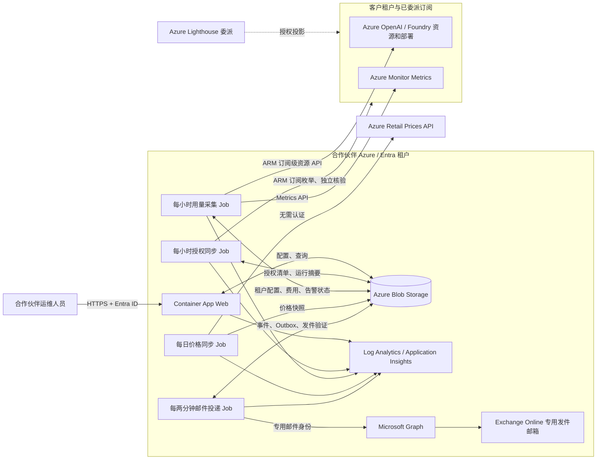

# Azure OpenAI 用量费用告警平台技术设计

> 校准基线：2026-10-06，按当前仓库代码、JSON schema 和 Bicep 模板核对。
> “当前实现”指已存在的代码能力，不代表所有生产加固、容量目标和供应商计费族已完成验收。
> 历史批次说明保留当时事实；后续规划不得用于推断当前 API、文件或安全控制已经存在。
> 邮件策略更新（2026-10-07）：费用恢复仅保留状态/事件，不发恢复邮件；超限及持续提醒的标题和正文均包含估算金额。
> 合作伙伴移交（2026-10-07）：新增明确选择的公网 HTTPS Blob/Consumption 安装 profile，原私网默认和当前实例不变；见 [安装指南](partner-installation.md)。

### 当前实现与源码索引

| 主题 | 当前实现 | 主要依据 |
| --- | --- | --- |
| 运行与调度 | Consumption Web + 四类独立 Job，Usage 可 1–16 分片；private 默认，public 为明确选择的新安装选项 | [部署模板](../infra/bicep/main.bicep)、[安装指南](partner-installation.md)、[Usage](../infra/bicep/usage.bicep)、[Pricing](../infra/bicep/pricing.bicep)、[Mail](../infra/bicep/mail.bicep) |
| 模型用量 | OpenAI/AIServices，Models `InputTokens/OutputTokens`，单完整小时 PT1H，资源发现缓存 2 小时 | [采集适配器](../packages/azure/src/usage-source.ts)、[执行契约](../packages/schemas/src/usage.ts) |
| 价格范围 | 官方只查询 Azure OpenAI Consumption/USD；其他 provider 不自动增加价格，可填手动文本 token 估算 | [价格源](../packages/azure/src/pricing-source.ts)、[价格配置](../packages/schemas/src/price-book.ts) |
| 费用与区间 | 通用 token 单位/SKU/区域/版本匹配，无模型名白名单；缺条件显示区间，缺计量不补零 | [计价](../packages/domain/src/usage.ts)、[汇总](../packages/domain/src/usage-summary.ts) |
| 历史 | 最多查询 240 小时；不默认回补、不自动 final；仅受控补算原金额缺失的真实暂定小时 | [持久化](../packages/azure/src/usage-store.ts)、[Job 入口](../apps/jobs/usage-collector/src/index.ts) |
| 告警与邮件 | 下限超限、6 小时提醒；新完整小时上限不超限才内部恢复，不发费用恢复邮件；持久化 Outbox，Graph accepted 非 Delivered | [状态机](../packages/domain/src/alerts.ts)、[事件](../packages/azure/src/alert-producer.ts)、[投递](../packages/azure/src/mail-dispatch.ts) |
| 授权与管理 | Lighthouse Reader、独立解除身份、待授权登记硬删除、名称/阈值编辑；无通用停用/软删除按钮 | [租户仓储](../packages/azure/src/index.ts)、[授权同步](../packages/azure/src/authorization.ts)、[API](../apps/web/server/src/app.ts) |
| 尚未交付 | Marketplace、非 token 全计费族、inventory 版本时间线、独立 maintenance、GitHub CI/CD、部分生产安全控制 | 见第 5–7 章的“后续要求”；不能按目标架构声称已实现 |

## 1. 目标、范围与明确限制

### 1.1 背景

合作伙伴需要集中监控客户通过 Azure Lighthouse 委派的订阅，按小时读取其中 Azure
OpenAI/Foundry deployment 的用量，根据 Azure 公开零售价估算客户总费用。当租户小时
费用超过预设阈值时，系统向合作伙伴运维人员发送邮件，并提供 24 小时概览和 10 天趋势。

系统是近实时费用**估算和告警平台**，不是 Azure 账单系统。第一版只面向 Azure
Public/Commercial Cloud。

### 1.2 目标

1. 无需保存客户用户凭据，跨租户读取客户明确委派的订阅、资源和 Azure Monitor
   platform metrics。
2. 每小时计算每个客户租户在所有已委派订阅中的 Azure OpenAI 估算费用。
3. 每天同步 Azure Retail Prices，保存当前价格 JSON 和 90 天历史快照。
4. 保存每个租户最多 10 天、240 个自然小时的费用和数据完整性状态。
5. 根据每租户 USD/小时阈值发送首次超限和持续提醒；恢复仅更新状态和历史，不发费用恢复邮件。
6. 在中文 Web GUI 中管理租户、阈值、授权状态、统一运维收件人和发件设置。
7. 提供所有租户 24 小时概览和单租户 10 天趋势。
8. 使用 TypeScript、Azure Container Apps、Blob JSON 和 Bicep 部署，不使用数据库。

### 1.3 主要用户和场景

第一版用户是合作伙伴运维人员。所有被显式分配到 Web Enterprise Application 的登录用户
具有相同业务权限。

主要场景：

- 生成 Lighthouse onboarding template，指导客户委派需要监控的订阅。
- 自动发现已授权客户和订阅，或预登记一个等待授权的客户 tenant ID。
- 设置租户显示名和 USD/小时阈值，显式启用租户；删除无委派的待授权登记，
  或通过解除管理/授权核验归档已接入租户。
- 查看所有租户最近完整小时、24 小时费用和异常状态。
- 查看单租户 10 天小时趋势及 subscription/resource/deployment breakdown。
- 管理统一运维收件人、验证 Microsoft 365 发件邮箱和发送测试邮件。
- 查看采集、价格、授权、价格映射和邮件投递问题。

### 1.4 第一版范围

当前采集 OpenAI/AIServices 的 Models token 用量。可计价部分是已具备适用单价、可关联
部署元数据和 token 计量的按量推理 deployment；不把“能采到模型”误称为“已有其价格”。
官方目录仍仅 Azure OpenAI，其他模型按用户后续提供的手动规则估算或保留金额未知。

第一版的金额口径为：

- USD Azure 公示零售价；
- 北京时间自然小时；
- 跨该客户所有已委派订阅的已支持 deployment 汇总；
- cached input 无法从聚合指标区分时按普通 input 单价计算；
- 结果明确标记为估算值，不代表客户最终账单。

以下为当前实现范围；第 7 章历史批次和后续规划不扩展其含义：

| 类别 | Phase 1 包含 | Phase 1 不包含 |
| --- | --- | --- |
| 云和币种 | Azure Public/Commercial、USD | Azure China、US Government、多币种 |
| 部署/用量 | OpenAI/AIServices，非空 provider format；Standard/GlobalStandard/DataZoneStandard 及明确 Batch SKU 的 token 规则 | PTU capacity-hour、训练/hosting、秒数/图片数等全计费族计量 |
| 模态/档位 | 已有适用 token 单价的文本/音频/图像变体、priority/flex/Batch；条件不足时估算区间 | 未测量模态、服务档位、缓存等条件的唯一实际账单 |
| 价格 | 官方 Azure OpenAI USD 零售价；手动文本 token 缺价规则 | 自动获取 Grok/其他 provider 价格、EA/CSP/MCA 成交价、实际账单 |
| cache | 普通 input 保守策略；已知写入不重复计价，未知写入纳入估算上限 | 从现有聚合指标自动还原所有 cached-token 精确折扣 |
| 告警对象 | 合作伙伴统一运维收件人 | 客户收件人、每租户邮件模板 |
| 历史 | 费用 10 天、价格 90 天 | 无限期历史 |
| 授权 | 订阅级 Lighthouse template | 资源组委派、多租户 Entra 应用主路径 |

### 1.5 后续范围

第二阶段通过独立计量适配器逐步覆盖：

- 更完整的 Batch/服务档位和可识别 cached input 计量；当前已存在对应 token 单价匹配，
  但不等于所有调用条件都能从小时指标还原；
- PTU/Provisioned；
- Realtime；
- Audio；
- Image/Video；
- Fine-tuning training/hosting。

Marketplace Managed Service offer 是 Lighthouse 模板验证后的授权渠道升级，不改变采集
核心逻辑。

### 1.6 非目标

第一版不提供：

- EA、CSP、MCA 折扣后实际成交价或 Cost Management 实际账单；
- prompt/completion 内容审计；
- 请求级用户归因或 chargeback；
- 客户直接登录和客户独立收件人；
- 多币种、主权云或按租户自定义时区；
- 无限期费用历史；
- 通用 Azure 成本管理；
- 自动修改或停止客户 Azure OpenAI deployment；
- 独立于 Graph 的系统故障通知通道。

### 1.7 关键设计决策

| 决策 | 选择 | 原因 |
| --- | --- | --- |
| 运行平台 | Azure Container Apps + Scheduled Jobs | 当前规模不需要新建 AKS 控制面 |
| 定时任务 | 独立 Job，不在 Web 容器中运行 timer | 避免重启漏跑和多副本重复执行 |
| 客户授权 | Lighthouse template，后续 Marketplace Managed Service | 适合服务商跨租户只读管理 |
| 客户范围 | 客户选择并委派所有要监控的订阅 | 支持完整资源发现和租户汇总 |
| 持久化 | Azure Blob 中的分片、带 schema 的 JSON | 无数据库约束下支持无状态扩缩和条件写 |
| Storage 网络 | VNet + Blob Private Endpoint + Private DNS | 管理租户策略禁止 Storage 公网访问 |
| 价格口径 | Azure Retail Prices USD | 可公开、自动同步，适合第一版估算 |
| 小时窗口 | `Asia/Shanghai` 自然小时，结束 15 分钟后处理 | 符合业务选择并容纳指标延迟 |
| 历史 | 费用 10 天，价格 90 天 | 满足趋势和审计需求并限制存储 |
| 邮件 | Microsoft Graph + Exchange Online Application RBAC | 适合无人值守且可限制发件邮箱 |
| Web 登录 | 合作伙伴单租户 Entra ID | 公网可达但不匿名开放 |
| IaC | Bicep | Azure 原生并可复用 Lighthouse 模板知识 |
| 环境 | 一个 Azure 生产环境 | 降低初期资源成本；以严格 CI/CD 和 revision 回滚缓解风险 |

### 1.8 已知限制

1. Retail Prices 是公示零售价，可能高于或不同于客户实际账单。
2. Azure Monitor 和价格 API 都可能有延迟；系统等待 15 分钟后读取上一完整小时，不默认回补。新资源最迟在两小时资源发现周期内纳入。
3. cached input 第一版可能被高估。
4. 未支持或无法匹配的 meter 会使结果变为 `partial`，不会按 0 美元处理。
5. Graph 完全不可用时没有独立主动通知，故障只能在 GUI 和日志中查看。
6. 仅有一个 Azure 生产环境，集成变更风险高于具有 nonprod 环境的方案。
7. Blob JSON 没有数据库事务和查询能力，因此必须分片、使用 ETag，并维护可重建物化视图。
8. 新型号采用既有可识别 token 协议且有适用价格时可自动匹配；全新单位/协议、缺价或
   缺少对应计量仍须扩展并验证，不能承诺任意未来计费方式都无需适配。
9. 告警事件和 outbox 项可以做到幂等创建，但 Microsoft Graph 投递不是端到端 exactly
   once；结果不确定时可能需要人工核对，并存在极少数重复邮件风险。

### 1.9 成功标准

- 授权客户能在一个小时内被自动发现，撤销授权能被明确标记。
- 正常情况下，小时结束后 30 分钟内产生 provisional 结果；容量与 Azure 限流需持续监控，不承诺未经负载验证的吞吐。
- 测试 deployment 的指标和费用与 Portal Metrics/零售价手工计算一致。
- 重试、重跑和回补不产生重复小时记录、告警决策事件或 outbox 项；邮件投递遵循本设计
  明确的 at-least-once/结果不确定处理语义。
- 部分数据、价格过期和未知 meter 在 GUI/邮件中可见，不产生“0 美元”的假正常。
- 所有 Azure ARM 资源可通过 Bicep 重建；Entra/Exchange 配置可由幂等脚本恢复，受保护的
  identity object ID 和 Lighthouse 外部授权按 runbook 恢复。

## 2. 总体架构与身份/客户授权

### 2.1 架构原则

系统采用 Azure Container Apps，而不是为该工作负载单独创建 AKS。当前实现支持多租户/
多订阅的有界并发和分片；模拟规模不等于真实云端容量保证。核心负载由一个网站、
Authorization/Usage/Pricing/Mail 四类定时任务和一个对象存储组成，不需要
Kubernetes 控制面的额外运维成本。所有容器均为无状态实例，JSON 数据保存在 Azure
Blob Storage。

主要原则如下：

- Web、用量采集、价格同步相互独立，任一组件失败不阻塞其他组件。
- 使用同一个 TypeScript 代码库构建可运行所有组件的镜像，通过不同 Node 入口运行；
  滚动发布期间可使用不同但兼容的 image digest。
- 任务按“至少执行一次”设计；同一窗口只有一条当前记录、原阈值不变。迟到数据可能
  更新暂定内容，幂等不意味着每次重复查询都必须返回完全相同金额。
- 客户资源访问、平台数据访问、用户登录和邮件发送使用相互独立的身份。
- 不把客户凭据、刷新令牌、Azure 客户端密钥或邮箱密码写入配置文件或 Blob。
- 无法完整采集或无法匹配价格时显式标记为 `partial` 或 `failed`，不得按 0 美元处理。

### 2.2 逻辑架构



#### 2.2.1 多客户租户与多订阅模型

系统明确支持以下基数关系：

```text
1 个合作伙伴管理租户
  -> N 个客户租户
    -> 每个客户租户 1..N 个已委派订阅
      -> 每个订阅 0..N 个 Azure OpenAI/Foundry account
        -> 每个 account 0..N 个 deployment
```

设计约束如下：

- 合作伙伴管理租户是平台、采集身份、Web 登录身份和 Lighthouse authorization
  principal 所在租户。
- `customerTenantId` 是客户隔离、阈值配置、小时费用汇总和历史查询的一级键。
- `subscriptionId` 是客户租户下的资源发现、授权覆盖和失败定位单元。
- Usage Collector 枚举合作伙伴通过 Lighthouse 可见的全部订阅，按
  `customerTenantId` 分组，并在全局及单订阅并发上限内并行采集。
- 一个客户租户的小时总费用等于其所有活动且已委派订阅中，全部受支持 deployment 的
  小时费用之和。
- 单个订阅采集失败只使所属客户租户的结果变为 `partial`；不得影响其他客户租户，也不得
  将缺失订阅按 0 美元计入。
- 数据、告警状态和 Blob 路径均按 customer tenant ID 分区，防止客户间数据串写。
- 同一 subscription ID 在一次授权快照中只能归属一个 customer tenant ID；出现冲突时
  停止该订阅计价并产生数据质量问题。

因此，该架构不是“一个部署对应一个客户”的单租户实现，而是一个合作伙伴平台实例同时
管理多个客户租户、且每个客户租户包含多个订阅的多租户实现。

### 2.3 Azure 组件

| 组件 | 形态 | 职责 |
| --- | --- | --- |
| Web | Azure Container App，外部 Ingress | 中文管理界面和内部 API；不运行定时器 |
| Authorization Sync | Scheduled/On-demand Container Apps Job | 每小时同步 Lighthouse 可见订阅，并支持 Web 手工触发 |
| Usage Collector | Scheduled Container Apps Job | 读取已同步 inventory、发现资源、查询上一完整小时的指标、计算费用和触发告警 |
| Pricing Sync | Scheduled Container Apps Job | 每天获取并校验 Azure OpenAI 零售价格，保存当前快照和历史快照 |
| Mail Dispatcher | Scheduled Container Apps Job | 恢复决策/claim，投递 Outbox；Collector 不调用 Graph |
| Blob Storage | StorageV2 | 保存 JSON 配置、价格、小时费用、告警状态和任务运行摘要 |
| Container Registry | Azure Container Registry | 保存 Web 和 Job 共用的版本化容器镜像 |
| Observability | Log Analytics + Application Insights 资源 | 当前读取 ACA 日志及 Blob Job 摘要；统一遥测/custom metrics 完整接入仍待加固 |
| Email | Microsoft Graph + Exchange Online | 从合作伙伴组织的专用邮箱发送业务和数据质量邮件 |

只有 Web Container App 开启外部 Ingress。用户通过 HTTPS 域名访问，不要求直接使用
固定公网 IP。四类 Job 均不开放入站端口。

### 2.4 身份分离

建议至少使用以下身份，不复用高权限身份：

1. **Web 登录应用注册**
   - 单租户 Entra ID 应用，仅允许合作伙伴租户用户登录。
   - 使用 Container Apps 内置身份验证。
   - 将“需要用户分配”设为启用，只允许显式分配的用户或组访问。
   - 第一版所有获准用户权限相同；服务端仍保留以后增加 Admin/Viewer 角色的扩展点。

2. **Web 数据身份**
   - Web Container App 的 user-assigned managed identity。
   - 仅授予业务数据容器所需的 Blob 数据权限。
   - 不授予客户订阅访问或邮件发送权限。

3. **采集身份**
   - Usage Collector Job 的专用 user-assigned managed identity。
   - 其 Entra object ID 写入 Azure Lighthouse onboarding template 和后续 Marketplace
     Managed Service plan 的 authorization。
   - 在客户委派范围使用 Azure 内置 `Reader` 角色，以读取订阅、资源、部署和 Azure
     Monitor platform metrics。
   - 同一 Collector identity 也供 Authorization Sync 使用，合作伙伴侧可写租户配置、
     inventory、audit、operations 和 usage，读价格；不能将其误写为配置仅只读。

4. **价格同步身份**
   - Pricing Sync Job 使用独立 managed identity 写入价格容器。
   - Azure Retail Prices API 为公开 API，不向它发送 Azure 访问令牌。

5. **邮件身份**
   - 使用独立 managed identity 或独立应用 service principal 调用 Microsoft Graph。
   - 通过 Exchange Online Application RBAC 仅授予
     `Application Mail.Send`，并把资源范围限制到 `chx@ms-ext.biz`。
   - 不给采集身份授予 Graph 邮件权限。

6. **解除管理身份**
   - 独立 user-assigned managed identity，不能与 Collector 共用。
   - 客户模板只给该身份授予 `Managed Services Registration assignment Delete Role`
     (`91c1777a-f3dc-4fae-b103-61d183457e46`)。
   - 该内置角色仅含 assignment read/delete 和 operationStatuses/read；不赋予客户
     业务资源写权限、Reader、Graph 或 Blob 数据权限。
   - 仅附加到 Web；Web 数据身份继续读写本地配置/审计，解除身份仅显式用于 Azure
     Lighthouse 预览与解除。受保护 object ID 不能随部署重建。

### 2.5 Azure Lighthouse 客户授权

第一阶段使用订阅级 Azure Lighthouse ARM/Bicep onboarding template。模板包含：

- 合作伙伴的 `managedByTenantId`；
- 稳定且不会随部署重建的采集 managed identity object ID；
- Azure 内置 `Reader` role definition ID；
- 独立解除管理 identity object ID 和 registration-assignment delete role；
- 可识别本服务的 `mspOfferName` 和 `mspOfferDescription`。

客户必须使用具有创建和删除角色分配权限的账号部署模板，并选择所有需要监控的订阅。
不要求把 B2B 来宾用户作为定时任务身份，也不要求客户向系统保存用户刷新令牌。

授权后的处理流程为：

1. 每小时 Job 枚举 Lighthouse 可见的委派订阅。
2. 按客户 tenant ID 聚合订阅，并与平台租户配置合并。
3. 新发现且未配置的租户进入 `discovered` 状态，等待运维人员设置名称和阈值后启用。
4. 运维人员也可以创建 `pendingAuthorization` 预登记项；发现真实委派后进入
   `discovered`，经显式配置启用才进入 `active`。
   “等待客户授权”且没有当前或待核验订阅的登记允许直接删除当前租户配置 JSON，
   不写 `deleted` 归档状态；保留审计和历史，不撤销 Lighthouse 委派。
   删除与授权同步共用租户 lease，并要求当前 ETag。同步快照中已被删除且无委派的
   登记跳过；仍存在真实委派时重新发现为待启用租户，不能依赖删除登记屏蔽授权。
5. 客户在 Lighthouse 撤销本应用委派后，完整订阅枚举成功且独立读取核验确认失去
   Collector 访问权，才把订阅移出当前监控及 expected set。全租户授权都被移出时，
   配置软归档为 `deleted`（界面“已解除管理”），保留历史，不删除 Azure 工作负载。
6. Collector 继续只有 Reader。旧客户未授权解除身份时，后台提供客户撤销指引；客户
   更新为“双身份”模板后，合作伙伴可只读预览、输入目标 ID 再确认，通过专用身份
   DELETE 本应用 registration assignment。重新授权使归档租户进入 `discovered`，需显式启用。

客户只更新 authorizations 时保持原 `mspOfferName` 和 registration IDs，不创建重复
套餐，不先删除旧委派。创建合作伙伴侧 identity 不等于客户授权；每个客户订阅仍需
管理员明确部署新版模板。

伙伴端解除操作要求：

- 使用单独身份 GET 带 `$expandRegistrationDefinition=true` 的订阅级委派列表；
  全部分页、客户 tenant、管理 tenant、套餐名称和两个精确 principal/role 组合均须验证。
- assignment 必须属于目标订阅；definition 必须是订阅级资源，且展开后的
  `manageeTenantId` 与目标客户、`managedByTenantId` 与合作伙伴匹配。允许客户在同一
  tenant 的不同订阅复用 definition，不要求 definition 与 assignment 的 subscription ID
  相同。只删除目标 assignment，绝不删除共享 definition 或其所在订阅的其他 assignment。
- 含有额外/eligible 主体、另一个委派共用 Collector、匹配不唯一或元数据不完整时拒绝；
  不接受浏览器自报的 assignment 资源 URL。
- 预览 10 分钟内有效，只有发起预览的登录运维用户能输入目标 UUID 确认。每次 DELETE
  前重新读取比对 fingerprint。
- 同一租户的解除操作通过 lease 串行；确认后作废该租户的旧预览，避免旧确认撤销
  客户后来重新创建的授权。
- Azure 200/202/204 只记为已提交，平台移出仍由授权同步验证。网络结果未知、部分
  未执行或失败明确记录，不自动重发 DELETE。

租户状态转换如下：

| 当前状态 | 允许进入 | 条件和影响 |
| --- | --- | --- |
| `pendingAuthorization` | `discovered` 或移除预登记配置 | 发现真实委派后进入 discovered；无当前/待核验订阅时可确认删除 JSON，不归档 |
| `discovered` | `active`、`disabled`、`deleted` | 配置阈值后可启用 |
| `active` | `degraded`、`disconnected`、`disabled`、`deleted` | 已确认撤销订阅自动移出；其他订阅正常则保持 active；全部移出则 deleted |
| `degraded` | `active`、`disconnected`、`disabled`、`deleted` | 确认移出后缩小 expected set；仍可见但 Disabled 的订阅保持 degraded |
| `disconnected` | `discovered`、`disabled`、`deleted` | 授权重新可见进入 discovered，不直接自动启用 |
| `disabled` | `active`、`degraded`、`deleted` | 重新启用需最近两小时内有效授权；全部委派已移出则归档 |
| `deleted` | `pendingAuthorization`、`discovered` | 手工重新登记只进入 pending；重新发现授权进入 discovered；历史保留期不延长 |

`degraded`、`disconnected` 和 `disabled` 都保留尚未超过 10 天的历史。删除配置不会扩展费用
数据的保留期。

### 2.6 Marketplace Managed Service 演进

验证模板方案后，可以把相同的 Azure Lighthouse authorization 发布为 Microsoft
Marketplace Managed Service offer。本设计的 Marketplace plan 只接受订阅级委派；客户
购买计划后选择要委派的订阅，资源仍由 Azure Lighthouse 投影到合作伙伴租户。

发布前需要满足以下前置条件：

- 有效的 Partner Center Microsoft Marketplace 账户；
- Infrastructure (Azure) 或 Security 的 Solutions Partner designation；
- 满足 Managed Service offer 的认证、法律条款、隐私和支持要求；
- 为公开计划确定稳定的授权主体和最小权限；计划中的授权会应用到购买该计划的所有客户；
- 需要按客户使用不同授权主体时，评估 private plan 的限制和维护成本。

模板与 Marketplace 两种方式应写入同一个“授权来源”字段，但不得形成两套采集逻辑。
系统只依赖最终可见的 Lighthouse 委派，不依赖客户通过哪种渠道创建委派。

### 2.7 非主路径与回退方案

如果某些客户无法使用 Azure Lighthouse，可在后续版本提供多租户 Entra 应用回退方案：
客户管理员同意应用后，还必须由 Subscription Owner 或 User Access Administrator 给客户
租户中的 Enterprise Application 分配订阅读取权限。该方案的客户操作更多、身份链路更
复杂，第一版不实现。

## 3. 采集、价格、费用和告警流水线

### 3.1 调度与时间窗口

Azure Container Apps Scheduled Jobs 的 cron 表达式使用 UTC。系统业务窗口统一按
`Asia/Shanghai` 自然小时划分，持久化时同时记录 UTC 时间戳和业务时区。

| Job | Cron（UTC） | 行为 |
| --- | --- | --- |
| Authorization Sync | `10 * * * *` | 同步 Lighthouse 可见订阅、inventory 和租户授权状态 |
| Usage Collector | `15 * * * *` | 每轮只读取上一完整自然小时的 PT1H 指标；资源清单按两小时缓存周期刷新 |
| Pricing Sync | `0 16 * * *` | 北京时间每天 00:00 同步 USD 零售价格 |
| Mail Dispatcher | `*/2 * * * *` | 恢复未完成决策、检查平台问题并处理到期 Outbox；支持手工触发预览测试 |

例如，北京时间 13:15 的任务计算 12:00–13:00，对应 UTC
04:00–05:00。等待 15 分钟可降低 Azure Monitor 指标延迟导致的漏记。每次 Metrics
请求的起止时间必须恰好相差一小时；不合并多小时查询，也不自动回读历史小时。

Container Apps Job 的 `parallelism` 和 `replicaCompletionCount` 均设为 1。由于平台按
“至少执行一次”运行，应用还需：

- 使用 Blob lease 保证同一采集分片在同一时刻只有一个有效执行者；
- 以 `tenantId + windowStartUtc` 作为小时结果幂等键；
- 使用 ETag 条件写入；配置/特定 saga 有各自冲突处理，价格发布或小时写入冲突可直接
  报错，不承诺所有 Blob 都自动合并/重试；
- 任务中断后允许安全重跑，不使用“先删除再全部重建”的更新方式。

### 3.2 授权、订阅与资源发现

授权订阅清单由每小时 Authorization Sync 更新；用量任务每小时读取单小时指标。
资源、deployment 和 metric definition 清单按订阅缓存两小时，发现流程如下：

1. 枚举采集身份通过 Azure Lighthouse 可见的订阅。
2. 读取订阅的 customer tenant ID，并与租户配置合并。
   - 保存上一成功同步的 `expectedSubscriptionIds`。
   - 所有页读取完整后，对消失订阅独立 GET 核验：仅明确 `AuthorizationFailed`（403）或
     `SubscriptionNotFound`（404）与完整列表共同构成 Collector 失去访问权的依据。
     对 Lighthouse 客户订阅，还识别完整同身份枚举确认缺失后返回的
     `InvalidAuthenticationTokenTenant`（401）；普通 401/令牌过期不作为撤销依据。
   - 核验确认后，将对应订阅移出 expected set，保留移出时间；全部移出则归档租户。
   - 列表失败时所有租户清单不变；单订阅核验失败时该租户配置与清单保持不变。Disabled
     订阅仍可见，不误判为撤销，不纳入实际采集。
3. 当前实现通过 ARM 订阅级列表读取 `Microsoft.CognitiveServices/accounts`，
   并按每租户订阅并发池执行。资源 Graph 批量发现保留为更大规模的后续优化选项。
4. 识别 `kind=OpenAI` 和 `AIServices`，统一按 Models - Usage 契约采集部署用量。
   不以模型 provider format 为 OpenAI 白名单；非 OpenAI 模型缺价时保留 token，不补零。
5. 通过 ARM deployment API 读取每个部署的：
   - resource ID、订阅、资源组和账号位置；
   - deployment name；
   - model name 和 model version；
   - SKU、deployment type 和 capacity；
   - 首次/最后发现时间及支持状态。
6. 对已删除的部署保留 tombstone，直到相关 10 天小时记录过期。

每个订阅独立保存 `subscriptionDiscovery.discoveredAtUtc`。每小时读取指标只更新
`observedAtUtc`，不会延长资源缓存有效期；缓存命中仍查询新一小时的 Metrics。
出现未识别部署、模型元数据变化或读取异常时，下一轮提前刷新该订阅清单。新资源可能
最多延迟两小时被发现，已发现资源的指标采集保持每小时执行。

资源清单不是人工配置的事实来源。用户可为租户预登记名称和阈值，但订阅、资源和部署必须
以 Azure API 的实际可见结果为准。

当前 inventory 是最新资源/部署快照及独立缓存，不是 observedFrom/observedTo/hash 的
append-only 版本时间线。通过首次/最后观察时间、tombstone、Metrics 模型/版本交叉核验
判断 `metadataVerified`；不能确认过去小时的元数据时保留 token 和错误，不套当前价。
完整版本时间线及任意历史元数据重建是后续能力，不能用于说明当前支持任意历史回补。

### 3.3 并发、限流与重试

面向几百个租户、每租户几百个订阅，使用有界 worker pool，不一次创建全部请求 Promise。
默认设置为：

- 每个采集分片最多 8 个租户并发；
- 每个租户最多 8 个订阅并发；
- 每个订阅最多 2 个 AOAI account 并发；
- 所有 Usage 分片共用 32 个管理面/Monitor HTTP 请求预算；每分片限制为
  `floor(usageRequestConcurrency / usageShardCount)`；
- 价格快照只读取、建立索引一次，按订阅完成结果汇总到对应 tenant，避免逐部署遍历全目录；
- Graph 发信最多 2 并发。

上述值通过环境配置调整，但必须设置安全上限。对 `429`、短暂 `5xx` 和连接重置：

- 优先遵循 `Retry-After`；
- 否则使用带抖动的指数退避；
- 每个请求设置超时和有限重试次数；
- 达到 Job 截止时间前停止启动新请求，把未完成项标记为失败；
- 不重试 `401`、`403`、无效资源 ID、无效指标名等确定性错误。

每轮记录租户、订阅、HTTP 并发峰值、请求数、429 次数、重试、缓存命中和总耗时。
单租户或订阅异常不阻断其他客户；截止时间后不再启动新工作，未完成部分显式标记，
不能填零。实际 Azure 延迟、资源密度与配额决定吞吐，模拟调度通过不等于一小时 SLA。

### 3.4 第一阶段指标采集

第一阶段只计算按 token 计费的 Pay-as-you-go 推理部署。核心 Azure Monitor platform
metrics 为：

| 用途 | REST metric name | 聚合 |
| --- | --- | --- |
| 输入 token | `InputTokens`（Models - Usage） | `Total` / Sum |
| 输出 token | `OutputTokens`（Models - Usage） | `Total` / Sum |
| 可选校验用总 token | `TotalTokens`，不计入费用重复求和 | `Total` / Sum |

查询规则：

- 每轮只查一个已完成 UTC 自然小时，固定 `PT1H`、`Total`，不默认回补多小时；
- 必须具备 `ModelDeploymentName`、`ModelName`、`ModelVersion`，并在可用时保留 `Region`、
  `ServiceTierRequest` 和 `ServiceTierResponse`；
- 部署的 model name、version、SKU 和 location 以 ARM deployment metadata 为主，
  metric dimensions 用于关联和交叉校验；
- 输入和输出分别计价，不把 `TotalTokens` 乘平均价，也不与旧 OpenAI 指标相加；
- metric API 成功且所有受支持部署均返回空/零时，才允许把租户该小时记为 0；
- API 失败、缺少必要维度或有未关联 deployment 时，结果必须为 `partial` 或 `failed`。

旧 `ProcessedPromptTokens/GeneratedTokens` 只保留为历史来源，不静默回退。新小时及明细
持久化 `metricFamily=models-usage`；已有历史 JSON 不重写。新的
`modelsMetricDimensions` 与旧维度缓存分开，不把 `FeatureName/UsageChannel` 用于新
Input/Output 查询，也不为切换指标而破坏两小时资源发现缓存。

Models token 指标通常没有实际服务档位维度；这时不得无条件套 Standard。根据既有可
适用的单价显示服务档位估算区间，维度明确时仍精确匹配。此次不扩大 Retail Prices
查询范围，不加入其他 provider 单价；Foundry/Grok 等用量可读取，无价金额显示“—”，
之后可由用户加入手动估算规则。`FoundryModelEstimatedCost` Preview 不是费用计算主源。

每个小时另有 `finality`：

- 窗口结束约 15 分钟后的第一次结果为 `provisional`；
- 根据最新单小时近实时需求，不默认回补，也不只因时间经过就将结果改为 `final`；
  现阶段小时结果保持 `provisional`。将来如需确认历史结果，需明确设计单小时重读机制；
- 第六批按单小时目标使用“新的完整小时未超限”判定估算恢复，不把小时升级为 final；
  2026-10-07 起恢复仅记录状态/事件，不发送费用恢复邮件，也不解释为账单确认；
- 保留对已有 final 历史记录的兼容性；失败的重复执行不得抹掉已确认历史金额。

Platform metrics 不要求客户额外创建 Log Analytics workspace 或 diagnostic settings。
本系统直接读取指标 API，客户数据不会因该功能被复制到客户或合作伙伴的日志工作区。

#### Phase 1 支持契约

当前支持契约由源码/schema/fixtures 版本化维护，没有独立的逐模型 support-matrix 文件：

- ARM resource/deployment API versions；
- 支持的 resource type/kind；
- 支持的按量 SKU：Standard/GlobalStandard/DataZoneStandard 以及明确
  Batch/GlobalBatch/DataZoneBatch；不把 token rate 用于未适配容量 SKU；
- metric names、aggregation、必需/可选 dimensions；
- Retail Prices API version、OData filter、分页规则；
- product/sku/meter label parser version；
- model/deployment type/region/direction 的协议/样本、缺版本/条件的安全行为。

kind/SKU/指标契约之外保留明确异常，不盲目试算；已有协议下的新模型名不需白名单。
缺价与条件不明导致的区间估算不能都归为 unsupported。协议改动须验证，不靠模糊型号猜价。

当前采集契约为（旧版 OpenAI 专用指标为历史口径）：

| 项目 | 固定值/规则 |
| --- | --- |
| Account resource type | `Microsoft.CognitiveServices/accounts` |
| Account kind | `OpenAI`、`AIServices`；必须通过运行时 Models 指标契约检查 |
| Deployment API | `Microsoft.CognitiveServices/accounts/deployments@2026-05-01` |
| PAYG deployment SKU | `Standard`、`GlobalStandard`、`DataZoneStandard`、`Batch`、`GlobalBatch`、`DataZoneBatch` |
| Metrics API | `Microsoft.Insights/metrics?api-version=2023-10-01` |
| Input metric | `InputTokens`，`Total`，精确 `PT1H` |
| Output metric | `OutputTokens`，`Total`，精确 `PT1H` |
| 必需维度 | `ModelDeploymentName`、`ModelName`、`ModelVersion` |
| 可选交叉校验维度 | `Region`、`ApiName`、服务档位/上下文/模态；以运行时 definition 为准，缺失不猜测 |
| Retail API | `https://prices.azure.com/api/retail/prices?api-version=2023-01-01-preview` |
| Retail filter | `contains(productName, 'Azure OpenAI') and priceType eq 'Consumption'`，USD，并跟随 `NextPageLink` |

不得把 Retail `serviceName` 过滤为 `Azure OpenAI`；当前相关 meter 的 serviceName 可为
`Foundry Models`。parser 规范化全部返回项；complete 指预期计量/价格覆盖完成，不表示
没有估算区间或已确认账单。未知单价/单位/元数据的不足仍为 partial/failed。

### 3.5 cached input 和第一阶段估算策略

Azure Monitor 聚合 prompt-token 指标不能保证拆出所有模型的 cache-hit token，而 cached
input 可能具有更低单价。第一阶段采用明确的保守策略：

- 所有无法区分的 cached input token 均按普通 input 单价计算；
- 历史小时可为 `cached-input-at-standard-rate`，rule version 3 新小时采用
  `model-independent-retail-range`，仍保留普通输入保守 cache-read 策略；
- GUI/邮件显示零售价估算、上下界及理由，不是实际账单上下界；未知缓存写入纳入上限，
  已知写入替换对应普通 input，不重复收费；
- 后续若 Azure 指标提供稳定的 cache 维度，可通过计量适配器增加精确规则。

### 3.6 每日价格同步

Pricing Sync 调用公开的 Azure Retail Prices API，仅处理 Azure Public/Commercial 和 USD。
同步器必须：

1. 使用固定 API 版本。
2. 查询 Azure OpenAI 相关的全部 Consumption meters，而不是维护一个模型白名单。
3. 逐页跟随 `NextPageLink`，直到完整取回结果。
4. 保存 API 原始字段，至少包括：
   `meterId`、`meterName`、`productName`、`skuName`、`armRegionName`、
   `retailPrice`、`unitOfMeasure`、`effectiveStartDate` 和 `type`。
5. 生成规范化价格键：
   - model family 和 model version；
   - input/output 或其他 meter direction；
   - Global、Data Zone、Regional 等 deployment type；
   - region 或 data zone；
   - service tier 和 meter variant；
   - 生效时间区间。
6. 保留 parser/rule version，避免规则升级后无法解释旧结果。

第三批当时仅提供价格目录；当前已接入 3.7 的通用 deployment 计价：

- 价格标识保留 `meterId/productId/skuId/armRegionName/tierMinimumUnits/
  isPrimaryMeterRegion/effectiveStartDate`，不把不同区域、梯度或生效版本合并。
- 单价保存为十进制字符串，原始 API 字段同时保留；按原始单位归一化 token、小时、
  秒、天、月和计数。未知单位标记 `unknown`，不回退为 token 或 0。
- parser 3 按 SKU 计费格式提取模型、版本、方向、部署区域和服务档位，不以固定模型/
  版本白名单批准。`supported` 表示符合通用 token meter 协议，不表示小时维度一定完整。
- 基准校验不依赖某个具体模型继续存在。币种错误、价格键冲突、分页缺失、空目录或
  没有可识别模型 meter 时失败；单个方向缺价在实际匹配时明确标为部分小计。

当前原始/规范化审计快照保存为 `pricing-current/aoai-pricing.json`，append-only 历史快照保存为：

```text
pricing-history/YYYY/MM/DD/aoai-pricing-<fetchedAtUtc>-<snapshotId>.json
```

历史价格保留 90 天。Storage lifecycle policy 只删除超过保留期的历史快照，不删除当前
快照。API 精确隐藏超过 90 天的备份；Azure 生命周期异步删除，账户软删除恢复期还可
保留最长 30 天可恢复副本，这不表示业务界面延长历史保留期。

Pricing Job 在 `operations/locks/pricing` 上获取 60 秒 Blob lease，并每 20 秒续租。
先完整获取并验证所有页，再以 `If-None-Match: *` 写入历史备份及精简查询目录，最后使用当前 ETag 条件
PUT 更新 active。备份、精简目录失败或 active ETag 冲突不得覆盖当前价格；备份已写但 active 更新
失败时，历史页只标为“已备份”，不声称该文件曾成为 active。

#### 精简目录与手动缺价补充

- 小时采集实际读取 `pricing-current/compact/v2/<snapshotId>.json`，不是仅优化下载。
  原始 active Blob 只读取 HEAD 元数据；精简目录缺失、损坏或来源不符时明确报错，
  不静默改读大文件，不补零。发布先准备目录再切换 active，当前快照可只生成精简
  文件，不改变原 `fetchedAtUtc`。滚动发布可读取已有 v1 精简目录，不回退到大 raw 文件。
- 目录统一 USD／1,000,000 token，保留模型、原始 SKU 标签、部署方式、服务档位、
  short/long/uniform 上下文、输入/输出/缓存方向、生效时间和每个区域的真实 meter ID。
  同模型/SKU/区域取最新已生效价格，不提前用未来价；只合并相同价格与条件的区域。
  若最新价刚生效，保留上一完整待计算窗口所需的前一价，避免午夜同步导致前一小时
  错误缺价；对每个小时仍选该窗口已生效的最新价，而不是保留全部旧日期。
  `scheduledRates` 保留快照下载时尚未生效的价格；查询按目标小时自动启用，不提前用价，
  也不等下一次每日下载才生效。训练、非 token、非 primary 和未确认梯度不用于
  普通 token 估算，但始终保存在原始/审计导出中。目录名称不等于计价适配已验证。
- **官方优先，手动仅补缺**：同模型/部署方式/区域有适用官方 token 价格时，不使用
  手动价覆盖。可用官方单价有多个上下文/模态价位时显示估算区间，而不是以模型未列入
  白名单拒绝计价。非 token 单位缺少对应计量时明确异常，不通过手动价绕过。
  官方缺价时才选择唯一已生效手动规则。
- `configuration/manual-pricing.json` 保存文本 token 模型名称、可选版本、部署 SKU、
  区域范围、输入/输出 USD/百万 token 单价、来源备注和版本区间。默认指定区域，
  可明确选择全部区域；不能假定不同区域的官方价格相同，范围也不证明部署可用。
  手动价按统一输入/输出计算，缓存输入按普通输入价，不区分上下文档位；不支持
  音频、图像、Realtime、embedding 等特殊计费。零价必须显式填写，缺价不默认为零。
- 新增、编辑、停用使用登录保护、同源 JSON、强 ETag、Blob lease 和不可变历史
  JSON：`operations/manual-pricing/history/<snapshotId>.json`。所有变更从下一完整 UTC
  小时生效；过去有效区间保留，同一小时尚未生效的修订可替换当前待生效项，审计
  仍逐次保留。禁止通配版本和具体版本的重叠区域，冲突不自动覆盖。
- 小时记录及 deployment 价格引用保留官方/手动来源、手动规则 ID/版本/快照；
  手动来源不伪造官方 meter ID。详情和告警邮件说明手动简化估算；既有小时金额不因
  配置保存而重算。新读取器兼容旧价格引用及 rule version 1/2，新增计算使用 version 3。
  只有原金额缺失的真实暂定小时可单独补算：使用原价格 snapshot、保留 token、采集时间
  和原阈值，写 before/after 审计，不覆盖已有可信金额或已确认结果。

原始分页链接仅允许 HTTPS `prices.azure.com` 固定路径，并保持 USD、API 版本及
AOAI Consumption 查询条件。短暂错误有限重试且遵守 `Retry-After`；每个请求有超时，
完整同步最多 25 分钟，Job 上限 30 分钟。运行摘要和失败代码写入
`operations/runs/pricing/history/<runId>.json`，最新摘要写入
`operations/runs/pricing/latest.json`。

每次下载完成以下校验后，直接原子替换当前 `active` 快照：

- HTTP 分页完整且结果非空；
- 必要字段和数值类型有效；
- USD、Consumption 和 Commercial Cloud 过滤符合预期；
- 同一规范化键不存在无法解释的冲突价格；
- 至少存在可识别的可计费模型 meter，不要求固定型号白名单；
- 与上一快照比较 meter 新增、消失、数量及价格变化，并写入同步运行摘要。

校验通过后，新快照自动且立即成为 `active`，同时保存不可变历史快照。价格或 meter
数量变化记录到同步运行摘要，但不阻断更新。符合既有结构化 token 计费契约的新增
meter 可自动参与匹配；无法识别或缺少计量的 meter 保留审计记录，不盲目计算。
适用价格消失或无法匹配时，受影响小时按 `partial` 处理并产生数据质量问题。
同步失败或校验失败时保留 last-known-good，不得用空文件覆盖当前价格。

active 快照距 `fetchedAtUtc` 超过 36 小时标记 `stale` 并告警；超过 72 小时后仍可形成
已知估算小计，但小时状态强制为 `partial`，不能触发恢复。

### 3.7 价格匹配

计价不维护模型名或固定发布日期白名单。解析器 v3 从明确的 SKU 标签提取
canonical `modelName`、版本提示、上下文、模态、方向与服务档位；
`modelIdentityStatus` 和顶层 `models` 提供名称索引。
Provisioned capacity、工具/免费通用 meter 标为 shared-service，不编造具体模型。
相同计费格式的未来模型只需进入官方目录，无需新增模型名代码。
输入/输出单价、按量 SKU、区域、版本与实际指标元数据仍须匹配；不猜测模型别名。
已有 v1/v2 快照可在 Pricing identity 下只重做元数据，写不可变备份后按原 ETag
更新 active；`fetchedAtUtc` 保持真实下载时间，另记归一化时间和来源 snapshot ID。

2026-10-05 重新查询 Retail Prices API，完整读取 24 页、23,870 条记录：当前目录已有
`6-luna` SKU，包括 Sweden Central 的 Standard Global 短/长上下文、缓存读取/写入
meter；尚未找到 `6.1-sol` 的精确 SKU，不能把 `6-sol` 自动视为其别名。
当时的 `UNSUPPORTED_PRICING_RULE` 是固定名单限制，已由通用匹配替代。当前 Luna、
Astra、5.6-Sol 不再因名称或版本未列入名单而拒绝计价。完全新的计费协议仍须有可对应
的计量；不能在缺少图像数、秒数、容量小时等数据时，声称得到了完整实际账单。

价格匹配的输入是 usage window、deployment metadata、metric dimensions 和价格快照。
匹配顺序为：

1. 根据小时开始时间选择已生效的价格。
2. 根据 model name 和 model version 匹配。
3. 根据 deployment SKU 选择 Global、Data Zone 或 Regional meter。
4. Regional meter 使用资源/指标对应区域；Global meter 不错误套用账号所在区域价格。
5. 根据 input/output 方向分别匹配。
6. 按 `unitOfMeasure` 归一化计量单位，禁止硬编码“每 1K”或“每 1M token”。
7. 维度明确时使用对应单价。维度不明确但有可解释的 token 单价集合时，计算最低/
   最高可能的既定零售价估算，保存上下界与原因，不把一个极值伪装成唯一费用。
   同一条件同日冲突仍失败；不同上下文、模态和合法变体不能错误合并。

价格生效区间统一解释为 UTC 半开区间
`[effectiveStartDate, nextEffectiveStartDate)`。token 数量为整数；价格和费用使用至少
28 位有效数字的十进制计算，`ROUND_HALF_EVEN`，中间明细不舍入。持久化金额保留
12 位小数，阈值用未格式化的持久化金额比较；界面显示时才按场景格式化。

每条费用明细保存 `meterId`、价格、单位、价格快照 ID 和匹配规则版本，以便审计。无法
匹配但用量大于 0 时，租户小时结果为 `partial`，并产生明确的 unmapped meter 记录。

#### 区间估算与告警

Monitor 分组如有上下文、模态或实际响应服务档位，则按每组 token 计价；所有分组数量
必须精确等于部署小时总量，不把小时累计输入误当作单次请求上下文。维度不足时保存
`costUsd/costUpperUsd`、`pricingUncertainty`，小时保存 `knownCostUsd/knownCostUpperUsd`。
缓存输入仍按普通输入保守估算；未知写入纳入上限，已计量写入替换对应输入、不重复收费。

- 详情、趋势、邮件显示同一估算区间；未知上限明确标记“上限未知”。
- 已知估算下限超过原阈值才超限；新的完整小时上限也在阈值内才内部恢复，不发费用恢复邮件。
- 相同 token 协议的新型号自动接入；单向 embedding、模态 token、priority/flex 和
  明确 Batch SKU 使用各自条件，不能把 Batch 折扣套到普通 Standard 请求。
- 图像个数、秒数、容量小时、训练/hosting 等缺少对应计量时保留原价并明确异常，不补零。
- 补算真实旧小时可产生唯一“历史小时补算”超限事件，不回退现时告警状态、不重放旧事件。
  仅该小时开始前已启用当前发件/收件配置时投递，否则抑制并记录原因。

### 3.8 小时费用计算

第一阶段每个部署的估算费用为：

```text
inputCost  = inputTokens  / inputUnitSize  * inputRetailPrice
outputCost = outputTokens / outputUnitSize * outputRetailPrice
deploymentCost = inputCost + outputCost
```

实现使用十进制定点库，不直接用 JavaScript 二进制浮点数累计金额。存储保留足够精度，
界面再按显示场景格式化。

第四批交付状态补充（历史记录；固定模型限制现已由 3.7 替代）：

- 此时测试订阅无模型用量，因此先完成只读发现、Metrics 请求、匹配、持久化和 GUI
  展示。不会主动调用模型产生测试费用；正用量金额验证标记为
  `awaiting-positive-usage-verification`。
- 固定计价规则先覆盖 GPT-4.1/mini/nano 的已确认版本和 token PAYG 类型。未知模型、
  未知服务层、上下文分档无法唯一确定、历史部署元数据未确认时只保留 token，
  不猜测费率。快照下载成功不等于全部模型可计价。
- `activity` 区分 `noDeployments/noUsage/hasUsage/unknown`。成功响应的空序列标为
  `noData`，并在页面解释为“未观测到用量”，不是接口失败。
- 部分授权或未匹配价格的小时可显示零“已知估算小计”，但完整估算总额仍为 null，
  状态保持 `partial`。完全无法采集则金额为 null。
- 第四、五批均只写 `provisional` 小时；最新需求取消默认回补，不提前宣称已确认。

租户小时结果状态：

| 状态 | 条件 | 可否判断低于阈值 |
| --- | --- | --- |
| `complete` | 预期覆盖完成，可为暂定/区间估算 | 只有上限也已知且在阈值内时可恢复 |
| `partial` | 至少一部分成功，但有资源、指标或价格缺失 | 不可以 |
| `failed` | 没有足够数据形成可信小计 | 不可以 |

`partial` 结果中的已知金额是“按本平台当前估算策略计算的覆盖部分小计”，是缺失资源加入
前的平台估算下界，但不一定是 Azure 实际账单下界；cached input 按普通 input 价时可能
高估实际账单。处理规则为：

- 已知金额已超过阈值：发送费用超限告警，并明确金额仍可能增加；
- 已知金额未超过阈值：不发送“正常”或“恢复”通知，只发送数据质量告警；
- 内部恢复须新的完整小时，且已知估算上限也不高于原阈值；不要求自动 final，不发送费用恢复邮件。

结果按租户和北京时间日期拆分，每个租户最多保留 240 个小时。清理按完整小时执行，不因
单次 Job 失败提前删除旧记录。

### 3.9 价格变化与重算

每日价格变化只影响后续计算，不自动批量重算已有历史金额。已实现的是独立、受控的
单小时“原金额缺失补算”，不是价格调整全量重算：

- 只接受保留期内、已经完整结束、`source=azure-monitor`、暂定且原 `knownCostUsd=null`
  的小时，使用其原官方 snapshot；已有可信金额或 final 不覆盖。
- 原 token、window、`collectedAtUtc`、原阈值不变；新写 `repricedAtUtc`、
  `pricingRepairAuditId` 和 rule version 3，保存 before/after JSON 审计。
- Job 一次性 `USAGE_OPERATION=reprice` 参数不得写入正常 schedule；不查询多小时
  Metrics，不为补算制造模型请求。
- 补算下限超阈值可生成唯一“历史小时补算”事件；仅当该小时之前已启用当前邮件设置
  才投递，否则抑制。不回退当前告警状态，不重放已有事件。

### 3.10 费用告警状态机

每个租户维护独立状态：

```text
normal -> breaching -> normal
```

规则如下：

- 持久化 `costState` 只有 normal/breaching，提醒和恢复是事件 kind，不是额外状态枚举。
- 第一个 `complete` 且已知估算下限超过阈值的小时产生超限事件。
- `partial` 的已知金额已经超过阈值时也立即发送，但邮件注明“部分数据，按当前估算策略的
  覆盖小计已超限”。
- 持续超限时每 6 小时最多发送一次提醒。
- 得到新的 `complete`，且已知上限不是未知、也不高于阈值时产生恢复事件并回到 normal。
  `cost-recovered` 保留在时间线，Outbox 直接记为 suppressed，原因
  `COST_RECOVERY_EMAIL_DISABLED`；这不阻止下一次超限重新产生首次告警。
- `partial` 或 `failed` 不能触发恢复。
- 当前不回读历史小时，也不自动生成 final。内部恢复采用
  `新的小时 + complete + 已知上限不高于阈值`，不要求 final，也不是账单确认。
  旧小时、partial 和 failed 均不能触发恢复。费用恢复不发邮件，数据质量恢复通知不受此策略影响。
- 阈值变更从下一个计算窗口生效，小时结果保存当时使用的 threshold snapshot。

每个邮件事件使用稳定的 deduplication key，例如：

```text
tenant-<tenantId>:<alertKind>:<windowStartUtc>
```

当前纯文本超限/持续提醒的标题含 USD 估算金额或区间；正文摘要按租户、估算金额、
小时阈值、北京时间窗口和中文完整性状态排列，说明/问题/详情在后。金额最多显示
6 位小数，去掉无意义尾零但至少保留 2 位；正数低于 USD 0.000001 显示“小于”，不舍入成零。
partial 始终标为“已知估算小计”，未知上限明确说明，不能把区间当作实际账单或额外消费。
保留原始事件金额和来源审计，不改历史费用；邮件不包含部署费用 Top-N。
Dispatcher 提交前同样检查恢复邮件策略，阻止旧 pending 或未开始提交的过期 claim；
已开始提交的 unknown 仍须人工核验，不能冒充未发送或撤回已被 Graph 接受的邮件。

### 3.11 数据质量告警

当前数据质量邮件使用两类来源，发送到统一运维收件人：

- 租户不完整小时中的授权覆盖、资源/部署发现、Metrics、价格关联等问题；
  按问题 code/resource ID 集合生成签名，断开授权也可生成对应租户事件。
- 平台健康检查：价格缺失/超过 36 小时、最近价格同步失败，授权同步缺失/失败/
  超过 2 小时，以及用量分片缺失/失败/超过 2 小时。

每个 subject 聚合问题而非按资源逐封发信。问题签名变化时生成首次事件，同一签名持续
存在时最多每 6 小时提醒；新的完整结果清除问题后生成恢复事件。通知开关、收件人和
授权检查仍适用，不保证每个未持久化的进程异常都会产生邮件。

当前按 subject 的 `qualitySignature/lastQualityEventAtUtc` 和不可变事件控制提醒，没有
独立 `operations/issues/...` 状态文档或 issues API。Mail Job 每轮核验价格、授权、用量
分片失败/新鲜度并生成 platform 事件；租户问题与 platform 问题不混用 subject。
Graph/Outbox 失败写运行摘要和 Outbox，GUI/日志可见，不递归尝试通过同一个
已故障 Graph 通道发送“邮件失败邮件”。

第一版不配置 Azure Monitor Action Group 作为独立通知通道。因此 Graph 邮件通道本身
完全不可用时，系统只能在 GUI 和日志中显示故障，无法主动发送兜底通知。

### 3.12 邮件投递

告警决策事件和 outbox 项是事实来源，alert state 只是可重建投影。使用 outbox-first
saga：

1. 在 subject lease 内保存 `current` 和 `pending(nextState, events)` 决策日志。
   pending 只表示准备写入，不表示告警状态已经推进。
2. 用 `If-None-Match: *` 写不可变事件与 Outbox，随后条件提交 state 并清除 pending。
   崩溃后从 pending 完成同一事件，不依赖重新读取历史 Metrics。
3. dispatcher 使用 ETag 把 `pending` 原子 claim 为 `claimed`，写入
   `claimOwner`、`claimExpiresAtUtc` 和提交次数 `attempts`（没有独立 attempt ID 字段）。
4. 发起 Graph 请求前写入 `submissionStartedAtUtc`。
5. Graph 返回 `202 Accepted` 后把状态更新为 `accepted`；该状态表示 Graph 接受请求，
   不证明最终送达。
6. 明确的限流/短暂服务端错误遵守 `Retry-After`，跨任务最多提交 5 次；永久错误变为
   `failed`。提交后的网络超时直接变为 `unknown`，不自动重发。
7. claim 到期且没有 `submissionStartedAtUtc` 时可安全回到 `pending`。
8. claim 到期且已经开始提交、但没有确定响应时更新为 `unknown`，不得自动重发；运维人员
   结合 Exchange trace 决定人工关闭或确认风险后重投。当前 resolve 只有 `close/retry`，
   不能从 unknown 手工冒充 Graph accepted。

Usage Collector 先恢复对应 subject 的 pending 决策，再评估新窗口；Mail Dispatcher
恢复未完成决策和过期 claim。测试覆盖这些持久化边界。

第六批职责分离：Collector 仅生成事件，不持有 Graph 邮件权限；Mail Dispatcher
恢复 pending 决策和 claim，最多并发投递两封。未授权、未启用或无收件人时真实发信关闭。
`suppressed` 表示仅记录事件；`previewed` 表示完成预览，没有请求 Graph 发信。

配置使用 `configuration/alerting.json`；决策日志使用
`operations/alert-state/<subject>.json`；不可变事件使用
`operations/alert-events/<subject>/<eventId>.json`；Outbox 使用
`operations/outbox/active/<eventId>.json` 与 `operations/outbox/archive/<eventId>.json`。
unknown 当前记录不按年龄删除。人工重发必须填写核对原因并携带 ETag，界面提示重复投递
风险；人工关闭记为 closed，不冒充 Graph accepted。

Graph `sendMail` 不提供通用的端到端幂等保证，因此邮件主题和正文包含短事件 ID，便于
识别极少数重复投递。

### 3.13 第二阶段计量适配器

“覆盖全部 Azure OpenAI 费用”不能使用一个 token 公式实现。第二阶段引入统一接口，每个
计费族单独实现 quantity collector 和 price matcher：

| 计费族 | 典型计量 |
| --- | --- |
| PAYG text/reasoning | input/output token、cached token、batch tier |
| Realtime | token 和/或 Realtime API 使用秒数 |
| Audio | 音频输入/输出 token 或音频秒数 |
| Image/Video | 图像、输出单位或相关 token |
| Fine-tuning | training token/小时、hosting 小时 |
| PTU/Provisioned | 部署 SKU、capacity 和生效小时，而不是 token 数 |

适配器必须声明支持的计费协议、SKU、metric、价格单位和精度等级。新的计费单位或
quantity 协议在适配并验证前不盲目计价；已有 token 契约下的新模型/meter 不需逐型号
发布规则。缺计量显示异常和已取得用量，不以 0 美元并入完整总额。

## 4. Blob 数据模型、API 与 GUI

### 4.1 TypeScript 应用结构

建议使用一个 pnpm workspace：

```text
apps/
  web/                 # React SPA + Fastify API
  jobs/                # authorization-sync、usage-collector、pricing-sync、mail-dispatch
packages/
  domain/              # 领域类型、费用和告警状态机
  azure/               # 当前 ARM、Monitor、Blob、Graph/Lighthouse 适配器
  schemas/             # Zod JSON/API schema
  ui/                  # Fluent UI 主题和共享组件
infra/
  bicep/
  lighthouse/
```

所有生产代码使用 TypeScript strict mode。Web 前端使用 React、Fluent UI React v9 和
Fluent Charts；Web API 使用 Fastify。前后端共享 Zod schema，避免 API、Job 和 Blob
文档分别维护不一致的类型。

同一个版本化镜像可根据命令运行：

```text
node /prod/server/dist/index.js
node /prod/authorization-sync/dist/index.js
node /prod/usage-collector/dist/index.js
node /prod/pricing-sync/dist/index.js
node /prod/mail-dispatch/dist/index.js
```

镜像中没有 `run-maintenance` 通用命令。Usage Job 的受控缺价补算是同一入口的
`USAGE_OPERATION=reprice` 一次性模式，不是每日 maintenance 或任意历史 Metrics 回补。

### 4.2 Blob 划分

不使用一个全局 JSON 文件。建议在同一 Storage Account 中按权限和生命周期建立容器：

| Blob container | 内容 | 主要写入者 |
| --- | --- | --- |
| `configuration` | 平台设置、租户配置、版本化手动缺价配置 | Web |
| `inventory` | 授权订阅、移出证据、当前资源/部署及缓存 | Authorization Sync / Usage Collector |
| `pricing-current` | 当前审计价格和版本化精简查询目录 | Pricing Sync |
| `pricing-history` | 90 天原始及规范化历史快照 | Pricing Sync |
| `usage` | 租户小时费用和 dashboard 视图 | Usage Collector |
| `operations` | 四类 Job 摘要、告警/Outbox、锁、发件验证、手动价/补算/解除管理审计 | Web/Jobs |
| `audit` | 租户配置与授权同步 append-only 审计 | Web / Authorization Sync |

角色以 Bicep 的具体 container scope 为准。Web 读取 pricing-current、pricing-history 和
usage；它还读写配置、inventory、operations、audit。Pricing 历史 API 由 Web 读取脱敏摘要，
不是尚待建立的专用适配器。Mail 身份读配置/价格、写 operations，不读取邮箱。

### 4.3 Blob 命名

```text
configuration/alerting.json
configuration/manual-pricing.json
configuration/tenants/<tenantId>.json

inventory/tenants/<tenantId>/subscriptions.json
inventory/tenants/<tenantId>/removed-subscriptions.json
inventory/tenants/<tenantId>/resources.json
inventory/tenants/<tenantId>/resource-cache.json

pricing-current/aoai-pricing.json
pricing-current/compact/v2/<snapshotId>.json
pricing-current/compact/<snapshotId>.json  # 旧 v1 精简目录兼容读取
pricing-history/YYYY/MM/DD/aoai-pricing-<fetchedAtUtc>-<snapshotId>.json

usage/tenants/<tenantId>/YYYY/MM/DD.json
usage/views/dashboard-24h/shards/<shardId>.json
usage/state/<tenantId>.json  # 兼容已有 final 水位；当前不自动生成 final

operations/alert-state/<subject>.json
operations/alert-events/<subject>/<eventId>.json
operations/outbox/active/<eventId>.json
operations/outbox/archive/<eventId>.json
operations/alerting-audit/<uuid>.json
operations/mailbox-authorization/<hash>.json
operations/manual-pricing/history/<snapshotId>.json
operations/usage-repricing/<auditId>/before.json
operations/usage-repricing/<auditId>/after.json
operations/runs/usage/history/<runId>.json
operations/runs/usage/latest.json
operations/runs/usage/shards/<shardId>.json
operations/usage-topology.json
operations/runs/pricing/history/<runId>.json
operations/runs/pricing/latest.json
operations/runs/authorization/YYYY/MM/DD/<runId>.json
operations/runs/authorization/latest.json
operations/runs/mail/history/<runId>.json
operations/runs/mail/latest.json
operations/locks/usage
operations/locks/pricing
operations/locks/authorization-sync
operations/locks/mail-dispatch
operations/locks/manual-pricing
operations/locks/alerts/<subject>
operations/locks/tenant-authorization/<tenantId>
operations/offboarding/operations/<operationId>.json
operations/offboarding/generations/<tenantId>.json
operations/offboarding/audit/<eventId>.json

audit/YYYY/MM/DD/<timestamp>-<eventId>.json
```

tenant ID、subscription ID 和 event ID 必须经过格式校验后才能参与 blob name 构造。
API 不提供任意 blob path 的读写接口。

### 4.4 通用 JSON 文档约定

各文档遵循自己的 schema，不能把通用示例作为所有 Blob 的固定字段集合：

```json
{
  "schemaVersion": 1,
  "revision": 3,
  "tenantId": "11111111-1111-4111-8111-111111111111"
}
```

约定如下：

- 时间使用 ISO 8601 UTC；窗口不另存 `windowLabel`，日期路径和 GUI 按 Asia/Shanghai 换算。
- tenant/subscription UUID 规范化小写；ARM resource ID 保留源值、比较时规范化，display name 保留原样。
- 美元金额在 JSON 中保存为十进制字符串，例如 `"12.345678"`。
- 多数 API/Blob Zod schema 使用 `.strict()`，新增字段未必被旧 reader 忽略；版本兼容
  必须逐项验证，不能笼统承诺同一 major 自动兼容。Retail raw 字段允许 passthrough。
- migration 先备份、先部署兼容 reader；目前没有通用 schema migration/dry-run CLI。
- 写入使用临时内存文档加 Blob `If-Match`/`If-None-Match` 条件，不使用无条件覆盖。
- 应用级 append-only 文档使用 `If-None-Match: *`，重复创建视为幂等成功或冲突检查。
  这不等于合规 WORM；如需防篡改保留，必须另外启用 Blob immutability policy。

### 4.5 平台配置

当前业务邮件配置为 `configuration/alerting.json`。时区/币种/保留期由代码和部署固定，
并发等由环境参数设置；没有 `configuration/platform.json` 或通用平台配置 API。
以下是安全的未启用示例，不是当前实例的启用配置：

```json
{
  "schemaVersion": 1,
  "revision": 1,
  "enabled": false,
  "senderMailbox": "chx@ms-ext.biz",
  "operationsRecipients": [],
  "reminderIntervalHours": 6,
  "recoveryPolicy": "new-complete-hour",
  "updatedAtUtc": "2026-10-06T00:00:00Z",
  "updatedByObjectId": "example-operator"
}
```

邮箱地址录入后规范化并去重。API 不回传任何认证凭据；该文档只保存邮箱地址和业务设置。
手动价格另存 `configuration/manual-pricing.json`，不是嵌在该邮件文档中。

### 4.6 租户配置

`configuration/tenants/<tenantId>.json` 示例：

```json
{
  "schemaVersion": 1,
  "revision": 4,
  "tenantId": "11111111-1111-4111-8111-111111111111",
  "displayName": "客户 A",
  "status": "active",
  "authorizationSource": "lighthouse-template",
  "hourlyThresholdUsd": "25.00",
  "notes": "",
  "createdByObjectId": "example-operator",
  "createdByName": "example.operator@ms-ext.biz",
  "createdAtUtc": "2026-09-20T01:00:00Z",
  "updatedAtUtc": "2026-09-29T04:00:00Z",
  "deletedAtUtc": null
}
```

`status` 只允许领域状态机定义的转换。预登记租户可以是
`pendingAuthorization`，但在发现真实委派前不能手工伪造为 `active`。订阅信息由
inventory 管理，不嵌入人工配置，避免授权变化覆盖用户设置。

### 4.7 Inventory

当前订阅快照保存：

- `subscriptionId/displayName/customerTenantId/state`；
- `firstSeenAtUtc/lastSeenAtUtc/lastValidatedAtUtc`。

它没有单独的 delegation-visible 布尔字段或完整角色时间线。移出证据在
`removed-subscriptions.json`，独立访问核验及同步错误另见授权运行和审计。

资源快照当前保存：

- Azure OpenAI account resource ID、kind、location；
- deployment name、model name/format/version、SKU（当前没有 capacity 字段）；
- 首次/最后发现时间和 tombstone 状态。

Inventory 只保存管理面元数据，不保存 prompt、completion、用户内容或 API key。

最新 resources 与缓存条件覆盖更新，保存 `firstObservedAtUtc/observedAtUtc/deleted`。
没有 append-only inventory history、metadata hash 或 observedFrom/observedTo 区间。

### 4.8 小时费用文档

`usage/tenants/<tenantId>/YYYY/MM/DD.json` 按北京时间日期保存最多 24 个小时：

```json
{
  "schemaVersion": 1,
  "tenantId": "11111111-1111-4111-8111-111111111111",
  "businessDate": "2026-10-06",
  "hours": [
    {
      "schemaVersion": 1,
      "tenantId": "11111111-1111-4111-8111-111111111111",
      "windowStartUtc": "2026-10-06T04:00:00Z",
      "windowEndUtc": "2026-10-06T05:00:00Z",
      "collectedAtUtc": "2026-10-06T05:15:00Z",
      "source": "fixture",
      "metricFamily": "models-usage",
      "status": "complete",
      "activity": "noDeployments",
      "finality": "provisional",
      "finalizedAtUtc": null,
      "estimatedCostUsd": "0.000000000000",
      "knownCostUsd": "0.000000000000",
      "knownCostUpperUsd": "0.000000000000",
      "thresholdUsd": "25.00",
      "inputTokens": "0",
      "outputTokens": "0",
      "priceSnapshotId": "22222222-2222-4222-8222-222222222222",
      "manualPriceSnapshotId": null,
      "pricingRuleVersion": 3,
      "estimatePolicy": "model-independent-retail-range",
      "validation": "awaiting-positive-usage-verification",
      "coverage": {
        "expectedSubscriptions": 1,
        "successfulSubscriptions": 1,
        "accounts": 0,
        "expectedDeployments": 0,
        "successfulDeployments": 0,
        "pricedDeployments": 0
      },
      "breakdown": [],
      "issues": []
    }
  ]
}
```

以上为本地模拟无部署小时，符合 [TenantDailyUsage/HourlyUsage 契约](../packages/schemas/src/usage.ts)，
不代表有部署/缺价/失败可以填 0。正用量明细另有 `costUsd/costUpperUsd/pricingStatus`、
`billingSlices/pricingUncertainty/prices`；受控补算可加 repricedAtUtc/pricingRepairAuditId。
当前写入不维护每小时 revision/adjustments，也不自动 final。

`breakdown` 按 subscription/resource/deployment 聚合，包含数量、匹配 meter 和金额，但
不包含请求内容。错误保存稳定 error code 和脱敏摘要，不保存 access token 或完整 Azure
SDK 响应。

### 4.9 告警状态与 Outbox

每个租户的告警状态投影单独保存，避免多个租户更新一个热点文件：

```json
{
  "schemaVersion": 1,
  "subject": "tenant-11111111-1111-4111-8111-111111111111",
  "current": {
    "lastEvaluatedAtUtc": "2026-10-06T04:00:00Z",
    "costState": "normal",
    "lastCostEventAtUtc": null,
    "qualitySignature": null,
    "lastQualityEventAtUtc": null,
    "notificationsEnabled": false
  },
  "pending": null
}
```

alert event/outbox 是事实来源，告警状态是可重建投影。active outbox 保存 event payload、
发件/收件地址、模式、settingsRevision、claim、attempts 和投递状态，不保存 OAuth token，也不保存渲染后的 HTML
正文。`accepted/failed/suppressed/previewed/closed` 为终态并归档；unknown 留 active，不按年龄自动删除。

### 4.10 Retention 和恢复

| 数据 | 当前/活动保留 | 历史版本/终态保留 |
| --- | --- | --- |
| usage 小时 | 查询/应用清理最多 240 小时 | Bicep 对 usage base/version 用 11 天按修改/创建时间兜底，另有 30 天软删除恢复期 |
| inventory 当前视图 | 最新资源/缓存、授权及移出证据 | 没有应用版本时间线；非专门 lifecycle 前缀不承诺自动 10 天清理 |
| pricing current | active 直到下一次成功同步替换 | previous versions 30 天 |
| pricing history | 不适用 | 90 天 |
| configuration | 租户、邮件、手动价格配置 | Storage 软删除 30 天；配置版本无专属 30 天清理规则，须独立运维策略 |
| active outbox | 直到 accepted/failed/人工关闭 unknown | 不按年龄自动删除 |
| archived outbox | 不适用 | 30 天；保存事件、发件/收件地址和投递结果，不保存模板 ID 或 HTML |
| Job runs | latest 指针及必要运行状态 | Pricing/Usage/Mail history 有 30 天生命周期；Authorization history 无专属规则 |
| alert events/alerting audit | 不适用 | 90 天 lifecycle；原生配置 audit 容器另需运维保留策略 |
| 其他 operations | 手动价历史、补算、解除/发件验证等 | 无统一 maintenance/TTL；未单独配置前不声称自动过期 |
| change feed | 当前 Bicep 未开启 | 不适用 |

Usage Collector 保存小时后对该租户执行 240 小时清理，不执行通用 operations maintenance。
停用/断开租户未写新小时仍在查询时过滤过期数据，usage lifecycle 用 11 天清理物理 Blob。
Outbox reconciliation/claim/archive 由 Mail Dispatcher 执行；lifecycle 不清 active/unknown。
pricing history 查询按 90 天隐藏，Storage 生命周期异步物理清理，不是立即硬删除保证。

当前模板使用 Standard_ZRS、versioning 和 30 天 soft delete，没有启用 change feed。
已部署的 previous-version 生命周期只覆盖上述特定前缀，不是所有配置/审计的统一 TTL。
是否增加其他版本清理、change feed 或 GZRS，应按恢复/合规目标另行设计与批准。

### 4.11 Dashboard 物化视图

Web 不应为每次概览请求实时读取 100 个租户的多日 blob。Usage Collector 完成后生成
`usage/views/dashboard-24h/shards/<shardId>.json`，保存轻量小时（breakdown 清空），包含：

- 生成时间和数据覆盖窗口；
- 所有活动租户的最近一小时金额、阈值和状态；
- 每个租户 24 个小时的 sparkline 数据；
- 汇总卡片、24 小时已知小计和超限/异常数量由前端计算，不作为冗余事实写入 view；
- 采集摘要由 API 合并对应 shard runs；价格摘要走独立 pricing API。

该视图可随时从租户小时文档重建，不是事实来源。Web 明确显示其 `generatedAtUtc`，过期
时通过窗口/分片覆盖表示缺失。各 shard 写独立视图，Dashboard API 直接合并；没有
Dashboard Materializer Job。没有任何视图时 API 可读小时文件作为回退；损坏视图返回
显式错误，不静默伪造重建成功。

### 4.12 API 设计

API 使用 `/api/v1` 前缀，主要端点如下：

| 方法和路径 | 用途 |
| --- | --- |
| `GET /session` | 当前可信平台/开发 principal |
| `GET /dashboard` | 固定 24 小时租户概览及分片覆盖 |
| `POST /usage/collect` | 同源空 JSON 请求启动固定小时采集 Job；202 不表示采集完成 |
| `GET /usage/status` | 最新用量采集摘要及失败原因 |
| `GET /tenants` | 查询租户和授权状态 |
| `GET /tenants?includeRemoved=true` | 同时返回已解除管理的归档租户；默认不返回归档 |
| `POST /tenants` | 创建预登记项，或把已归档租户重新登记为 pendingAuthorization |
| `GET /tenants/:tenantId` | 租户配置与 ETag；订阅/资源 inventory 走独立查询 |
| `PATCH /tenants/:tenantId` | 同源 JSON、强 If-Match 和租户 lease 下修改非归档租户名称/小时限额；不修改授权或启用状态 |
| `POST /tenants/:tenantId/enable` | 名称、小时阈值和当前 etag 放在 JSON 请求体中，显式启用已发现租户；不是通用状态修改接口 |
| `POST /tenants/:tenantId/offboarding/preview` | 只读预览本应用的租户/订阅委派范围；缺少客户授权时明确阻止 |
| `POST /authorization/offboarding/:operationId/execute` | 同源 JSON、相同操作者、目标 UUID 确认后执行受控解除 |
| `GET /authorization/offboarding/:operationId` | 查询持久化操作及逐订阅结果；不因超时假定成功 |
| `POST /authorization/sync` | 启动固定授权同步 Job |
| `GET /authorization/runs/latest` | 最新授权同步摘要 |
| `GET /tenants/:tenantId/usage?hours=240` | 1–240 小时（默认 240）趋势/明细、当前资源与采集摘要 |
| `GET /tenants/:tenantId/subscriptions` | 查询自动发现的订阅 |
| `DELETE /tenants/:tenantId` | 同源空 JSON、当前单个强 If-Match 和租户 lease；仅硬删除等待授权且无当前/待核验订阅的登记，保留审计历史 |
| `GET /pricing/status` | 当前快照摘要、更新时间/新鲜度及最近同步 |
| `GET /pricing/download?format=compact` | 默认精简 aoai-pricing.json，含官方目录和手动备用项 |
| `GET /pricing/download?format=raw` | 完整 aoai-pricing-raw.json；固定 ETag 私网流式读取，无 Blob URL/SAS |
| `GET /pricing/history?limit=10&cursor=...` | 最近 90 天备份摘要，稳定游标分页，每页最多 50 条 |
| `POST /pricing/sync` | 同源 JSON 请求启动价格 Job，202 只表示已启动，不表示已同步完成 |
| `GET /operations/mail` | 最新邮件 Job 摘要 |
| `GET /operations/outbox?limit=20&cursor=...` | active/archive 邮件列表，稳定游标 |
| `GET /operations/outbox/:id` | 单个 Outbox、ETag、投递错误/人工处置 |
| `POST /operations/outbox/:id/resolve` | 强 If-Match，填写核对原因后 retry/close |
| `GET /tenants/:tenantId/alerts` | 租户事件时间线 |
| `GET/PATCH /settings/alerting` | 编辑发件邮箱和运维收件人；更换邮箱关闭通知，未验证新邮箱不能启用真实自动通知 |
| `POST /settings/alerting/test` | 发送测试邮件 |
| `GET/POST /settings/manual-pricing` | 手动缺价列表/新增；官方范围/区域选项，强条件创建 |
| `PATCH /settings/manual-pricing/:id` | 强 ETag 更新版本，从下一完整小时生效 |
| `POST /settings/manual-pricing/:id/disable` | 强 ETag 停用，保留版本/审计 |

约定：

- 所有业务端点要求 Entra ID 登录。
- 对已有配置/处置使用强 ETag 和 If-Match；首次创建可用 If-None-Match。各 API 根据
  是否为前提冲突/业务冲突返回 412/409，不能笼统说全部修改都同一响应。
- 输入使用 Zod 校验；金额、GUID、时间范围和邮箱地址有显式约束。
- 错误使用 `application/problem+json`，包含稳定 error code 和 correlation ID。
- pricing history/outbox 有分页和上限；当前 tenants 是完整列表，不伪称已分页。
- 查询范围超过 10 天返回 `400`，不静默截断。
- API 响应不暴露 Blob SAS、内部异常堆栈或 Azure access token。

### 4.13 GUI 信息架构

第一版界面和邮件使用简体中文。

#### 费用概览

- 顶部卡片：最近完整小时估算费用、24 小时费用、超限租户、数据异常租户、最近采集时间。
- 租户表格：租户、最近小时费用/阈值、24 小时费用、24 小时 sparkline、授权和数据状态。
- 支持名称/ID 搜索、完整性/无记录等状态筛选、已知金额降序或名称排序；无“超限程度排序”。
- `partial`、`failed`、`disconnected` 必须比金额更醒目，不能用 0 美元代替。

#### 租户详情

- 10 天小时趋势图和阈值线。
- `complete`、`partial`、`failed` 使用颜色加图标/纹理区分。
- 支持查看某小时的 subscription、resource、deployment 费用明细。
- 显示保守 cached-input 策略、价格快照、覆盖率和错误。
- 告警时间线展示首次超限、提醒、恢复和数据质量事件。

#### 租户与授权

- 已发现、待授权、管理中和已解除管理分组；领域枚举包含 disabled/disconnected，
  但没有通用“停用租户”或任意软删除 API/按钮。
- 手工预登记 tenant ID、名称和阈值。
- 提供 Lighthouse template 下载/部署说明；Marketplace source 仅预留枚举，无购买/升级入口。
- 显示每个租户已委派订阅以及最后一次权限验证时间。
- “解除管理”提供权限预览和输入 ID 确认；客户未更新解除身份授权时保留客户侧撤销
  指引。“已解除管理”标签显示归档租户、移出订阅和历史入口。
- 授权同步通过全局 lease 串行化；每租户授权更新和采集提交共用租户 lease。采集只在
  提交前确认租户仍活动且授权范围未变时写入；范围变化的在途结果丢弃。最新授权状态会
  覆盖旧费用视图的成员列表，防止下一轮物化前仍显示已移出的租户。
- 当前订阅 JSON 保持原结构，移出证据单独保存在 `removed-subscriptions.json`；配置和
  费用历史不硬删除。重新授权的订阅会使旧资源缓存失效，不沿用上一次委派的发现结果。

#### 设置

- 统一运维收件人列表。
- 输入并保存 Exchange Online 发件邮箱；显示发送权限验证状态。变更地址自动关闭通知，
  管理员独立完成单邮箱 App RBAC，真实测试被 Graph 接受后才能再手动启用。
- 权限验证记录以“发件邮箱 + 专用 Mail identity client ID”为键保存到
  `operations/mailbox-authorization/<hash>.json`；预览、网络未知结果不能充当授权。
  Graph 的权限/邮箱拒绝使验证未通过，现有部署已验证的初始邮箱保持向后兼容。
- 测试邮件。
- 时区、币种和保留期是固定实现/部署契约，不提供 GUI 通用修改。
- 当前价格快照、默认精简 SKU JSON 下载，以及单独的原始/审计快照下载；最近自动
  同步结果、价格变化摘要和 90 天脱敏历史入口。精简目录包含实际查询的 token 价格
  和手动备用规则；原始导出包含所有未支持 meter，不能误称为全部模型可计价。
- 手动价格管理：新增/编辑/停用文本 token 缺价规则，模型与输入/输出单价必填，
  显示部署方式、明确区域范围、生效时间与“官方优先”；默认指定区域。

#### 运行状态

- Usage/Pricing/Mail 的最近运行摘要、已记录的单次耗时/计数及错误；授权同步继续在
  租户与授权页查看。没有跨运行的历史成功率报表。
- 采集/价格问题在对应摘要和租户小时详情中查看，没有统一 issues 列表/API。
- 价格未匹配、同条件冲突或不支持的协议显示明确错误；合法多条件估算区间不是失败。
- 邮件 outbox 的 pending、claimed、unknown、failed 和 Graph accepted 项。

### 4.14 Microsoft Copilot 风格与可访问性

视觉实现使用 Fluent UI design tokens、Segoe UI Variable、浅色中性背景、白色内容面板和
Microsoft 蓝色强调色。避免大面积渐变、过度阴影和装饰性动画；使用清晰留白、紧凑表格
和轻量 sparkline。

可访问性要求：

- 满足 WCAG 2.2 AA 的颜色对比、键盘导航和焦点样式；
- 状态不只依赖颜色，必须同时有图标和文字；
- 图表提供 tooltip、键盘访问和等价数据表；
- 金额和大 token 数按中文区域格式显示，但复制值保持机器可读；
- 支持桌面和常用平板宽度；手机端至少可完成查看和告警确认。

## 5. 安全、可靠性和运维

### 5.1 数据分类与最小化

系统保存的数据包括客户 tenant/subscription/resource ID、deployment 元数据、聚合 token
用量、估算费用、邮箱地址和运行错误。这些数据按合作伙伴内部机密信息处理。

系统不采集或保存：

- prompt、completion、system message 或 embedding 内容；
- Azure OpenAI API key；
- 客户用户身份或请求级调用者信息；
- 客户 B2B 用户密码、刷新令牌或浏览器会话；
- Microsoft 365 邮箱密码。

Application Insights 和结构化日志不得记录 access token、完整 HTTP Authorization
header、Blob SAS、邮件正文或原始 Azure SDK 错误响应。

### 5.2 Web 安全边界

- Container Apps 只暴露 443/HTTPS 外部 Ingress，HTTP 自动重定向到 HTTPS。
- 使用单租户 Entra ID 内置身份验证，未认证请求返回登录跳转或 `401`。
- Entra Enterprise Application 开启“需要用户分配”，只授权合作伙伴运维用户/组。
- 第一版所有已授权用户业务权限相同；API 仍从可信平台头读取并记录用户 object ID。
- 应用只信任 Container Apps Easy Auth 注入的身份，不接受客户端自报 tenant/user header。
- 当前修改类 API 使用同源/JSON/Origin、sec-fetch-site 及具体配置的强 ETag 条件；
  身份/cookie 由平台 Easy Auth 管理，没有应用自建统一 CSRF token/cookie 策略。
- 当前没有显式 CSP/frame-ancestors/HSTS/nosniff 全套响应头中间件，也没有业务 API
  rate-limit 插件；这些是生产加固要求，不以 ACA HTTPS 等价替代。
- React 文本渲染默认转义；当前邮件为纯文本，不渲染自定义 HTML 模板。
- 当前有 Zod 长度/输入、查询窗口、部分列表分页上限及 Fastify 默认 body limit；
  统一流量限制和完整响应头安全验收列入后续。

### 5.3 Azure 身份与权限

| 身份 | 主要权限 | 明确禁止 |
| --- | --- | --- |
| Web login app | 用户登录 | 客户资源、Blob 数据、Graph |
| Web managed identity | 配置/inventory/audit/operations 读写，价格/usage 读取；四类固定 Job 的 scoped Operator | 不以此身份读客户资源、直接 Graph 发信或启动任意 Job |
| Collector managed identity | Lighthouse `Reader`、指定 Blob 容器 | 修改客户资源、Graph |
| Offboarding managed identity | 客户明确授予的 Lighthouse assignment read/delete | 删除模型/订阅、创建委派、Graph、Blob 数据 |
| Pricing managed identity | pricing/operations Blob 写入 | 客户资源、Graph |
| Mail identity | Exchange scoped `Application Mail.Send`，配置/价格 Reader、operations Contributor、AcrPull | 读取邮箱、客户资源 |
| Deployment identity | 部署资源和分配本租户 RBAC | 运行时业务访问 |

Azure Lighthouse 采集身份使用独立 user-assigned managed identity；删除保护是运维要求，
当前 main.bicep 显式声明的是 Offboarding identity 的 CanNotDelete lock，未对 Collector
声明该锁，不能声称模板已经同时保护两个身份。其
object ID 被所有客户 onboarding template/Marketplace plan 引用；误删后创建同名身份
也不会恢复原 object ID，客户需要重新授权。

定期执行权限审查：

- 列出当前 Lighthouse registration assignments；
- 校验 authorization 中的 principal 和 role；
- 检查合作伙伴订阅内的 managed identity RBAC；
- 检查 Exchange Application RBAC 的 mailbox scope；
- 检查 Web Enterprise Application 的用户/组分配。

### 5.4 Microsoft Graph 邮件权限

使用 Exchange Online Application RBAC 把 `Application Mail.Send` 限制到专用发件邮箱。
不要再叠加一个租户级、未限定范围的 Entra `Mail.Send` grant，否则权限可能是累加的，
从而绕过预期 mailbox scope。

邮件身份只负责发送，不需要 `Mail.Read` 或 `Mail.ReadWrite`。如需限制只能发给合作伙伴
运维地址，应用已按允许域校验收件人；若生产需要 Exchange 级硬性收件限制，还必须独立实施：

- 当前 API 按 `MAIL_ALLOWED_DOMAINS` 的域名列表校验，没有独立地址级 allowlist 参数；
- Exchange transport rule 是额外生产要求，configure-mailbox-rbac.ps1 不建立该规则，
  本实例也未改变正常邮箱通信规则。

Application RBAC 只限制可作为发件人的邮箱，不限制收件人。allowlist 变更通过受控部署
参数完成，不由普通 GUI 用户扩大。

第六批在 `ms-ext.biz` 的实际授权与验证状态（2026-10-04）：管理员已完成此前
`Enable-OrganizationCustomization` 前置配置，核对 `IsDehydrated=false`。
专用 Mail identity 的 `Application Mail.Send` scope 仅包含 `chx@ms-ext.biz`，
未添加组织范围的 Graph `Mail.Send` 或邮件读取权限。
Web 和邮件 Job 均为 `mailAuthorizationReady=true`；默认 false 仍用于保护新部署。
一次真实测试经 Graph accepted、Exchange Delivered 和用户确认完成送达验收。
应用不因此把 Outbox 的 accepted 状态改成 delivered。

经用户确认，当前测试实例自动告警已启用，统一收件人为 `chx@ms-ext.biz`，
持久化配置已读回核验。应用端允许收件域仍为 `ms-ext.biz`，不补发关闭期间的旧事件。
本轮未修改该邮箱正常通信的 transport rules。生产推广前仍须独立确认专用发件
邮箱/Exchange 收件限制方案，避免影响已有正常邮件；该生产要求尚未完成验收。

### 5.5 Storage 安全

生产环境要求：

- 禁止 Blob 匿名访问；
- 禁用 Storage Account shared key，仅使用 Entra ID 数据面授权；
- 最低 TLS 1.2；
- Container Apps 环境必须接入 VNet，Storage 必须使用 Private Endpoint 和 Private DNS；
- Storage `publicNetworkAccess` 必须为 `Disabled`，不得以临时公网例外绕过；
- 使用 managed identity 和容器级 RBAC，不在环境变量保存 connection string；
- Defender for Storage 与异常访问告警属于后续生产加固，当前 Bicep 未声明开通；
- 默认使用服务端加密；只有合规要求时再引入 customer-managed key。

本地开发使用 Azurite，不访问 Azure Storage。所有 Azure 环境均执行上述私网约束，不提供
Storage 公网访问例外。

### 5.6 供应链和容器安全

- ACR 关闭 admin user，Container Apps 使用 managed identity `AcrPull`。
- 多阶段构建，只把生产依赖和编译产物放入运行镜像。
- 已有 Docker 多阶段构建、`USER node`、production deploy、frozen lockfile 和部署 digest。
- 当前 Docker 基础镜像是 `node:24-alpine`（major 标签，不是 pinned patch/digest），没有
  readonlyRootFilesystem/临时卷的模板控制。不可将 non-root 等价于只读根文件系统。
- 仓库无 `.github/workflows`，没有自动 SBOM、镜像/依赖扫描、secret scanning 或
  production OIDC workflow。此类供应链要求及其验收仍属于第七批。
- 现有 lint/typecheck 是 TypeScript 检查，Vitest/Playwright/构建命令可本地执行；
  没有独立 formatter 检查流水线。
- 不在镜像层、构建参数或前端 bundle 中写入 tenant ID 之外的敏感配置。

### 5.7 配置审计

当前不同操作使用各自审计位置，不统一写到 operations/audit：

```text
audit/YYYY/MM/DD/<timestamp>-<eventId>.json           # 租户及授权变更
operations/alerting-audit/<uuid>.json                  # 邮件配置
operations/manual-pricing/history/<snapshotId>.json   # 手动价版本
operations/usage-repricing/<auditId>/before.json      # 缺价补算意图
operations/usage-repricing/<auditId>/after.json       # 已保存结果
operations/offboarding/audit/<eventId>.json           # 解除管理
```

事件包含操作者 object ID、操作、目标、时间、correlation ID、变更字段列表和成功/失败
结果；并非每类都含相同 correlation/changedFields 字段。手动价历史和补算会保存版本/
before/after 业务 JSON，邮件配置审计可含 sender/recipient 摘要；不能声称所有业务值都只
保存 hash。仍不保存认证凭据或完整邮件正文。只有明确 lifecycle 前缀有自动保留规则。
应用使用条件创建；这不是防特权管理员删除的 WORM。若合规
要求防篡改，再为专用 audit container 启用 immutability policy。

### 5.8 可用性目标

第一版建议采用以下可验证目标：

| 指标 | 目标 |
| --- | --- |
| 小时 provisional 新鲜度 | 完整小时结束后 30 分钟内生成 |
| 小时 final 新鲜度 | 当前不自动确认；需后续显式单小时重读方案 |
| 正常情况下价格新鲜度 | 北京时间 00:30 前完成每日同步 |
| Dashboard 新鲜度 | Usage Job 成功后 5 分钟内更新 |
| 单次短暂故障恢复 | 当前请求有限重试；旧小时缺口保持显式，不默认回补 |
| 历史手工回补 | 当前不开放；如以后增加，必须按单小时执行 |

这些是应用目标，不等同于 Azure 实际账单 SLA。系统无法保证 Azure Monitor 或 Retail
Prices 上游数据没有延迟。

### 5.9 容错策略

- Web Container App 最少 1 个、最多 3 个 replica；多 replica 通过 ETag 安全写配置。
- Job 对短暂错误重试，但总执行时间必须小于下一个计划窗口。
- 当前价格失效时使用 last-known-good，并把结果标记为 stale/partial。
- Dashboard 可以由正常采集/受控补算更新；当前 API 在没有视图时读小时文件回退，
  损坏视图报错，不自动重建并声称成功。
- 某客户失败不终止其他客户；Job 最终状态区分
  `succeeded`、`succeededWithWarnings` 和 `failed`。
- 写 Blob 前在内存完成 schema 校验；条件写失败不会破坏旧版本。
- 所有外部调用使用明确 timeout 和 AbortSignal。

### 5.10 备份与灾难恢复

- Azure ARM 基础设施由 Bicep 重建；Entra/Exchange 配置由幂等管理脚本恢复。
- 应用镜像保存在 ACR，并至少保留当前和上一个可回滚版本。
- Blob 使用 ZRS；需要区域级灾难恢复时升级 GZRS/RA-GZRS，并制定账号故障转移流程。
- 配置、价格和 usage 的 previous versions 由生命周期控制，不永久保留。
- 定期执行恢复演练：恢复一个租户配置、重建 dashboard、重跑一个小时、从历史价格重算。
- 采集 managed identity 和 Marketplace/Lighthouse authorization 是不能仅靠重建名称恢复
  的外部依赖，必须使用资源锁、变更审批和单独 runbook 保护。

### 5.11 可观测性

当前 Web 使用 Fastify/Pino（请求 ID/身份头脱敏），Jobs 输出各自 event/运行摘要 JSON。
下列统一日志字段与完整遥测仍为建议标准，并非每条现有日志已经包含：

```text
timestamp, level, service, version, runId, correlationId,
tenantId, subscriptionId, resourceIdHash, operation, outcome,
durationMs, errorCode
```

resource ID 在不影响排障时使用 hash；禁止记录 access token。建议自定义指标：

- Job 成功/警告/失败次数和耗时；
- 最近一次成功 Job 的时间；
- 活动/断开连接租户和订阅数量；
- 发现的 AOAI 资源和 deployment 数量；
- Monitor 请求数、429 数和重试数；
- `complete`/`partial`/`failed` 小时数量；
- stale price 年龄和 unmapped meter 数；
- 告警首次触发、提醒、恢复数量；
- outbox pending/claimed/accepted/unknown/failed 数量；
- Blob ETag 冲突和 lease 获取失败数量。

GUI 的“运行状态”读取结构化 Job 摘要作为业务事实；Application Insights 用于技术诊断，
不让 GUI 直接依赖任意 KQL。

### 5.12 健康检查

- `/health/live`：进程事件循环可响应，不访问外部依赖。
- `/health/ready`：调用 tenant repository.checkReady，检查 configuration/audit/inventory/
  operations 容器可访问，不代表 pricing/usage/Graph/ARM 或全部业务文档均健康。
- 价格过期、客户权限失败等业务问题不让 Web readiness 失败，而在运行状态中显示。
- Jobs 启动时校验环境并检查所需存储；启动前失败可只有 stderr event，不保证已能写
  run summary，更不声明全面角色/Exchange 授权预检已经执行。

### 5.13 运维 Runbook

至少建立以下操作手册：

1. 客户 Lighthouse 委派消失或权限不足。
2. Azure Monitor 持续 429、超时或指标定义变化。
3. Retail Prices API 失败或 meter 数量异常变化。
4. 新模型有用量但价格无法映射。
5. Blob ETag 冲突、schema 无法迁移或文档损坏。
6. Graph 请求失败、Graph accepted 但未送达、Exchange scope/transport rule 错误或邮箱
   被禁用。
7. managed identity、Storage、ACR 或 Container App 被误删。
8. 单小时原缺价补算审计、原 snapshot/阈值/数量保留及幂等事件；通用历史 Metrics
   回补不开放。unknown 重投仍须人工核对风险。
9. 回滚容器镜像和 Bicep 版本。

### 5.14 通知通道限制

第一版不使用 Azure Monitor Action Group、短信、Teams 或 Webhook 作为独立故障通道：

- Graph 本身故障时，邮件发送失败只能在 GUI 和日志中发现；
- Web 与邮件同时不可用时没有主动通知；
- 运维人员需要定期查看平台运行状态。

生产上线评审应再次评估该风险；新增外部通知通道需要单独的设计和变更审批。

## 6. Container Apps 与 Bicep 部署

### 6.1 环境策略

当前交付记录是一套 `ms-ext/aoai-cost-alert-test-rg` 集成验收实例，容器按 production 模式
禁止开发身份/共享密钥。尚未建立独立完整 production/nonprod CI/CD 拓扑，不能把严格
运行模式或一个健康 revision 等价于正式生产安全验收。代码不禁止今后增加环境。
本地使用 Azurite、mock/fixtures；真实 Azure 集成验证须按批准边界执行。

该选择降低成本，但具有以下已知风险：

- 未隔离多个 Azure 环境时，集成变更/错误会影响当前验收实例；
- 新模型和新 meter 只能使用脱敏 fixture 验证后再在生产小范围观察。

实际当前发布为批准后的 CLI/Bicep/ACR 操作和 multiple revision；完整自动人工门禁/
OIDC/灰度流水线是正式生产要求，不是现有 workflow。

### 6.2 生产资源拓扑

建议使用一个专用 resource group，并部署：

```text
Resource Group
├── Virtual Network
│   ├── Container Apps infrastructure subnet
│   └── Private Endpoint subnet
├── Container Apps managed environment
│   ├── Web Container App
│   ├── Authorization Sync Job
│   ├── Usage Collector Job
│   ├── Pricing Sync Job
│   ├── Mail Dispatcher Job
│   └── Usage Collector 分片 Jobs（按容量启用；API 合并分片概览）
├── Azure Container Registry
├── Storage Account
│   ├── configuration
│   ├── inventory
│   ├── pricing-current
│   ├── pricing-history
│   ├── usage
│   ├── operations
│   └── audit
├── Log Analytics workspace
├── Application Insights
├── User-assigned managed identities
└── Private Endpoints / Private DNS zones（private profile）
```

Web 使用 Container Apps 外部 Ingress 和 HTTPS FQDN。第一版可以使用平台默认
`azurecontainerapps.io` 域名；正式品牌域名可绑定自定义域名和托管证书。四类 Job 不启用
Ingress。

### 6.3 Bicep 目录

```text
infra/bicep/
├── main.bicep
├── test-subscription.bicep
├── prod.bicepparam.example
├── partner-public.parameters.example.json
├── pricing.bicep
├── usage.bicep
├── mail.bicep
├── README.md
└── scripts/
    ├── configure-entra-auth.ps1
    └── configure-mailbox-rbac.ps1

infra/lighthouse/
├── subscription.bicep
├── subscription.json
├── subscription.parameters.json
└── README.md
```

Bicep 管理 Azure ARM 资源。Entra application registration、Container Apps Easy Auth 的
身份提供方细节和 Exchange Online Application RBAC 不完全属于同一 ARM 控制面，使用
可重复执行的 Microsoft Graph/Exchange Online 脚本配置，并记录人工管理员同意步骤。

### 6.4 命名和参数

现有 `prod.bicepparam.example` 为非敏感参数示例；模板参数以 main.bicep 为准，
不应把推荐项误当作已经参数化：

- Azure region；
- 资源名前缀和全局唯一后缀；
- `storageAccessMode` 默认 private；新实例可明确选择 public，Consumption/Storage
  `Standard_ZRS`/Log Analytics retention 30 天保持不变；
- 合作伙伴 `mailSenderMailbox/mailAllowedRecipientDomains` 同时传给 Web/Usage/Mail；
- image repository 和 digest；
- 默认域名或自定义域名；
- 资源 tags。

tenant ID、client ID 和 managed identity object ID 可以作为部署输出或受控参数，但
client secret、证书、connection string 和邮箱凭据不得提交到 Git。

tags 是可覆盖参数；默认只有 application/environment/dataClassification，
owner/costCenter 是建议，不是代码强制的现有标签。

### 6.5 身份和 RBAC 部署顺序

1. 创建长期稳定的 user-assigned managed identities。
2. 创建模板中的 Offboarding CanNotDelete lock；Collector 的删除保护需独立检查落实。
3. 创建 Storage、ACR 和 observability 资源；当前没有 Key Vault 资源模块。
4. 在具体 Blob container scope 分配数据角色。
5. 给 Web/Job identities 分配 `AcrPull`。
6. 管理员独立提供并配置 Easy Auth 凭据；当前脚本设置 ACA auth secret，不是 Key Vault 引用。
7. 部署 Container Apps environment、Web 和 Jobs。
8. 输出 collector identity object ID，生成 Lighthouse 参数示例。
9. 使用独立管理员流程配置 Web Entra 登录和 Exchange Application RBAC。

RBAC assignment 使用确定性 GUID，重复部署不得产生重复 assignment。角色生效有延迟，
部署后的 smoke test 应带退避重试。

### 6.6 Container App 配置

Web 初始配置：

- `minReplicas: 1`；
- `maxReplicas: 3`；
- 基于 HTTP concurrency 扩缩；
- multiple revision mode；
- liveness 和 readiness probes；
- 外部 Ingress，仅 443；
- user-assigned managed identity；
- ACR 通过 managed identity 拉取；
- 当前没有 Key Vault reference；configure-entra-auth.ps1 接收已有 ClientId/securestring
  ClientSecret 后更新 Easy Auth，不负责创建 Entra app、secret 或用户分配。

应用环境变量只保存：

- Blob account endpoint 和 container names；
- 若部署提供的观测连接参数（资源存在不等于完整 OTel SDK 已接入）；
- managed identity client IDs；
- 业务时区和功能开关；
- API timeout、并发和重试上限；
- 应用版本和 schema reader/writer version。

### 6.7 Scheduled Job 配置

实际四类 Job 的 cron 为 UTC，模板 command 都是 `node`，args 指向对应入口：

| Job | cron | replicaTimeout 秒 | replicaRetryLimit | Node 入口 |
| --- | --- | ---: | ---: | --- |
| Authorization Sync | `10 * * * *` | 900 | 2 | `/prod/authorization-sync/dist/index.js` |
| Usage Collector | `15 * * * *` | 1500 | 1 | `/prod/usage-collector/dist/index.js` |
| Pricing Sync | `0 16 * * *` | 1800 | 1 | `/prod/pricing-sync/dist/index.js` |
| Mail Dispatcher | `*/2 * * * *` | 420 | 1 | `/prod/mail-dispatch/dist/index.js` |

各 Job parallelism/replicaCompletionCount 均为 1；Usage 单分片处理预算默认 1200 秒。
Usage Collector：

```text
triggerType: Schedule
cronExpression: 15 * * * *
parallelism: 1
replicaCompletionCount: 1
replicaRetryLimit: 1
replicaTimeout: 1500
command: node
args: /prod/usage-collector/dist/index.js
```

Pricing Sync：

```text
triggerType: Schedule
cronExpression: 0 16 * * *
parallelism: 1
replicaCompletionCount: 1
replicaRetryLimit: 1
replicaTimeout: 1800
command: node
args: /prod/pricing-sync/dist/index.js
```

第五批 Usage Collector 在同一分片 lease 内执行：

```text
read authorization/inventory and one pricing snapshot
-> tenant worker pool
-> per-tenant subscription worker pool
-> refresh resource cache only when expired (2h)
-> query exactly one complete hour through shared HTTP limiter
-> aggregate to each tenant and conditionally persist
-> write lightweight dashboard shard view
-> prune retained hourly data
```

精确资源规格通过负载测试确定。即使平台重试或两个 schedule execution 重叠，Blob lease
和幂等键仍保证不会并发写出重复小时、告警事件或 outbox 项；Graph 最终投递仍遵循
3.12 节的非 exactly-once 语义。

默认使用一个 usage Job。若基准预测 P95 执行时间超过 12 分钟，或实测连续三个窗口超过
12 分钟，在继续增加客户前必须启用分片：

- Bicep 参数 `usageShardCount` 创建多个同 cron Job；
- `stableHash(tenantId) mod usageShardCount` 决定租户所属 shard；
- 单分片沿用 `operations/locks/usage`，多分片使用 `operations/locks/usage/shards/<shardId>`；
- shard 写各自的 `usage/views/dashboard-24h/shards/<shardId>.json`；
- API 并行读取小型分片视图并合并，不再为每次概览重读所有租户的大型明细文件；
  分片缺失或过期时显式显示覆盖率，不能冒充完整总额；
- 改变 shard count 时先停止并排空旧执行，再显式重置 `operations/usage-topology.json`；
  否则运行时拒绝混合拓扑。缩容还需定向删除不再使用的旧 Job，不能只依赖增量 Bicep。

### 6.8 网络

原实例和默认 `storageAccessMode=private` 的 Container Apps environment 接入 VNet：

- Storage 从第一批使用 Private Endpoint；当前 ACR 未声明 Private Endpoint、Key Vault
  未部署。将其他依赖私网化是后续设计，不能从 Blob 私网推断它们已配置；
- 配置对应 Private DNS zones 并链接到 VNet；
- Web Ingress 保持 external，Storage 等数据服务不公开；
- Job 当前访问 Azure Resource Manager/Monitor、Retail Prices、
  Microsoft Graph 和 Entra token endpoints；
- 不需要固定出站 IP；若未来客户防火墙要求 allowlist，再增加 NAT Gateway。

网络策略应使用 Azure 服务 FQDN/服务标签能力，不维护易过期的硬编码公网 IP 列表。

新合作伙伴可显式选择 `storageAccessMode=public`：创建 Consumption profile 的 Azure
默认网络环境，不创建本项目 VNet、Blob PE/DNS；Storage 开启公网网络连接，但匿名访问、
Shared Key 和 container-public access 仍关闭，HTTPS/MI/RBAC 不变。public 不是公开 JSON。
两种模式不改变采集、计价或邮件规则；不得原地切换现有环境的网络类型。
新选项为模板级交付，不表示已经在合作伙伴订阅做过真实部署/权限验收。

### 6.9 Lighthouse onboarding template

`infra/lighthouse/subscription.bicep` 在客户订阅范围部署
`Microsoft.ManagedServices/registrationDefinitions` 和
`registrationAssignments`。参数包括：

- `mspOfferName`；
- `mspOfferDescription`；
- `managedByTenantId`；
- collector identity principal ID；
- `Reader` role definition ID；
- 独立 offboarding principal ID 和 `Managed Services Registration assignment Delete Role`。

模板不创建/修改客户业务资源；Collector 只读，独立身份获 assignment 删除权，不是
“两个主体都只有 Reader”。客户部署前必须展示被授权的合作伙伴 tenant、
principal、role 和 scope。部署后验证：

1. 客户 portal 的 Service providers 页面可见委派。
2. 合作伙伴采集身份能列出该订阅。
3. 能发现 Cognitive Services/OpenAI account。
4. 能读取 metric definitions 和一个无副作用的历史 metrics 窗口。
5. UI 中租户从 `pendingAuthorization` 或未知状态变为 `discovered`。

### 6.10 Marketplace 准备

从模板升级为 Managed Service offer 时复用相同：

- managing tenant；
- collector principal；
- 内置 Reader role；
- 仅订阅级 scope，不在第一版 plan 中开放资源组委派；
- 授权后的平台自动发现逻辑。

Marketplace plan 更新不会自动强制已有客户接受新权限。增加或修改授权后，已有客户需要
在 Service providers 页面审阅更新。系统不得假设所有客户已同步到最新 plan。

### 6.11 Entra Web 登录配置

当前 configure-entra-auth.ps1 只接受 ResourceGroup/ContainerAppName/TenantId/ClientId/
ClientSecret，更新 ACA Easy Auth/未认证跳转。其余 Entra 管理操作须管理员完成：

- 创建或引用单租户 Web application registration；
- 设置 Container Apps 回调 URI；
- 启用 ID token；
- 创建、保管和轮换 client secret；当前不保存到 Key Vault；
- 配置 Container Apps 内置 Entra 身份验证；
- 设置未认证请求行为；
- 开启 Enterprise Application 的 assignment required；
- 输出需要分配的运维组。

secret/证书必须有到期监控和轮换 runbook。若 Container Apps 后续支持满足需求的无 secret
配置，应迁移并移除旧凭据。

### 6.12 Exchange Online 发件配置

配置脚本以管理员身份：

1. 确认组织邮箱 `chx@ms-ext.biz` 存在且可发送。
2. 在 Exchange Online 注册 mail identity service principal。
3. 创建只包含 `chx@ms-ext.biz` 的 management scope。
4. 分配 `Application Mail.Send`。
5. 脚本不修改 transport rule；如生产要 Exchange 级收件限制，另行授权与验收。
6. 当前脚本核验 sender 的 scoped Mail.Send；其他发件/收件负面测试仍是独立生产要求。
7. 从应用发送到运维收件地址并验证 Graph accepted、Sent Items/消息跟踪。

邮箱地址和 scope 名是参数，不在代码中硬编码。

### 6.13 GitHub Actions（后续生产要求，当前未实现）

仓库目前没有 `.github/workflows`；以下是待交付方案，不是现有流水线。当前可执行的
验证以根 package.json scripts、Vitest/Playwright 和 Bicep build 为准，发布记录采用 CLI。

CI workflow：

1. 安装锁定版本的 Node/pnpm。
2. lint、format check、TypeScript type check。
3. unit、contract、fixture 和 UI tests。
4. 构建 Web/Job。
5. Bicep build 和 lint。
6. 容器构建、依赖/镜像漏洞扫描和 SBOM。

生产部署 workflow：

1. 使用 GitHub OIDC federated credential 登录 Azure，不保存 deployment client secret。
2. 执行 Bicep what-if 并保存输出供人工审阅。
3. 要求 GitHub production environment 人工批准。
4. 推送不可变 image digest。
5. 部署基础设施兼容变更。
6. 创建 Web 新 revision，先不切全部流量。
7. 对 revision 执行登录、health、Blob 读取和只读 API smoke test。
8. 切换流量并观察错误率。
9. 更新 Jobs 到相同兼容版本。
10. 手工触发小范围/只读预检，再恢复正常 schedule。

部署身份不拥有客户 Lighthouse Reader 权限，CI 不能读取客户 usage。

### 6.14 Schema 兼容和回滚

只有一个生产环境时，Blob schema 变更必须遵循 expand/contract：

- 新 reader 先兼容旧字段；
- writer 再开始写新字段；
- 至少保留上一个应用版本可读取的新旧格式；
- destructive migration 必须备份、dry-run 和人工批准；
- 回滚镜像前验证其最大可读 schema version；
- 物化 dashboard 可删除重建，但配置和 usage 不能作为缓存处理。

### 6.15 首次部署与验收顺序

1. 部署 identities、网络、Storage、ACR、observability 和 Container Apps。
2. 配置 Web Entra 登录并只分配实施人员。
3. 配置 Exchange Online 发件权限并发送测试邮件。
4. 手工运行 Pricing Sync，验证当前和历史 JSON。
5. 用内部测试订阅部署 Lighthouse template。
6. 手工运行资源发现和一个历史小时采集，不启用真实邮件。
7. 对照 Azure Portal Metrics 手工核对 token。
8. 对照 Retail Prices meter 手工核对金额和单位。
9. 验证阈值首次告警、6 小时提醒、恢复、数据质量告警和 outbox crash recovery。
10. 启用 Scheduled Jobs 和正式运维收件人。

## 7. 分阶段交付、测试与验收

### 7.1 MVP 首迭代技术验证

不设置独立 Phase 0。以下工作作为 MVP 第一个迭代的实现任务，与 Web 页面骨架并行：

1. 用 collector user-assigned managed identity 完成一次 Lighthouse 模板授权，并从
   Container Apps Job 读取测试订阅、AOAI deployment 和一个完整小时的 input/output
   metrics。
2. 从 Retail Prices API 为该 deployment 找到唯一 input/output meter，与 Portal Metrics
   和手工金额计算对照。
3. 用受 Exchange Application RBAC 限制的专用邮箱发送测试邮件，同时验证其他邮箱发送
   会失败。
4. 用 Azurite 和一个手工 Container Apps Job 验证 Blob ETag、lease、重复执行和 outbox
   幂等行为。

这些验证不是单独交付阶段，但对应链路失败时应立即修正实现和设计，不能用 mock 成功结果
继续掩盖问题。

### 7.2 Phase 1：PAYG token MVP

当前交付范围以 1.4 节为准。已存在代码能力包含：

- Lighthouse subscription template 和授权说明；
- 自动发现租户、订阅、AOAI account 和 deployment；
- 待授权预登记及无委派登记硬删除、启用、名称/小时阈值编辑、Lighthouse 解除与归档；
- 每日 Azure Retail Prices USD 快照和 90 天备份；
- PAYG input/output token 小时费用估算；
- cached input 按普通输入价计算并标记保守估算；
- 10 天小时历史、24 小时所有租户概览和租户详情；
- 首次超限、6 小时提醒和数据质量邮件；费用恢复仅状态/事件，不发恢复邮件；
- Graph/Exchange 专用组织邮箱；
- 中文 Fluent UI GUI；
- Container Apps、Blob、ACR、observability 和 Bicep；
- VNet-integrated Container Apps Environment、Blob Private Endpoint 和 Private DNS；
- ACR/CLI/Bicep 发布记录及 multiple revision；不把未交付 GitHub CI/CD 算作完成。

明确不包含：

- EA/CSP/MCA 客户实际成交价和实际账单；
- 现有条件不足时的唯一实际费用、cached-token 精确折扣；
- PTU capacity、秒数/图片数、fine-tuning training/hosting 等全计费族；
- 自动获取非 Azure OpenAI provider 价格（用量可采集，缺价可后续手动补）；
- 客户收件人和按租户邮件模板；
- 多币种、主权云和多业务时区；
- 独立于 Graph 的系统故障通知通道；
- Marketplace offer 发布本身。

### 7.3 Phase 1.1：生产加固和 Marketplace

- 运行至少一个完整价格变更周期并复核规则。
- 引入更多客户前完成负载基准和限流调优。
- 完成 Marketplace 资格、法律、隐私、支持和认证材料。
- 发布 private/test Managed Service plan，验证购买、委派、更新和撤销。
- 确认模板与 Marketplace 客户使用同一发现和采集路径。
- 根据真实运维反馈决定是否增加 Action Group/Teams 等独立故障通道。

### 7.4 Phase 2：全计费族

按计量适配器逐类交付，而不是一次启用“全部”：

1. Batch/service tier 和可识别的 cached input。
2. PTU/Provisioned capacity-hour。
3. Realtime。
4. Audio。
5. Image/Video。
6. Fine-tuning training/hosting。

每个适配器上线前必须有：

- 官方 metric/meter 依据；
- 支持的 model、version、SKU 和 region matrix；
- quantity 单位和价格单位转换测试；
- 有真实 Azure 资源的对照样本；
- unknown/new meter 的显式失败测试；
- 对旧小时记录和告警行为的兼容说明。

“全覆盖”定义为支持矩阵中的计费族全部通过验收，不代表未来 Azure 新增 meter 会被自动
猜测支持。

### 7.5 测试策略

#### 单元测试

- 北京时间自然小时和 UTC 转换；
- 十进制 token/价格/金额计算和舍入；
- price effective date、region、deployment type 和 input/output 匹配；
- ambiguous/unmapped price 不返回 0；
- `complete`/`partial`/`failed` 状态；
- 首次告警、6 小时提醒、恢复和数据质量状态机；
- 10 天/90 天 retention 边界；
- ETag merge 和幂等键；
- cached-input 保守策略；
- 新完整小时触发估算恢复，旧小时/partial/failed 不恢复；
- deployment metadata 版本关联和 unresolved 历史窗口；
- expected subscription 部分丢失与 degraded 状态；
- 价格 active/stale 状态、自动替换和 last-known-good 回退。

#### Property-based 测试

以下列出期望覆盖的不变量；当前主要是 Vitest 示例/边界/模拟规模测试，没有独立
property-based/fuzz 测试工具。不得因为列出这些目标就声称随机生成测试已交付。

- 任意非负 token 和非负价格不会产生负费用；
- breakdown 之和等于租户已知小计；
- 重复处理相同窗口不增加小时条目和邮件事件；
- `partial`/`failed` 永不触发恢复；
- 时间窗口不重叠、不丢小时。

#### Contract/fixture 测试

保存脱敏的 Azure Monitor、ARM deployment 和 Retail Prices 响应 fixture，覆盖：

- Global、Data Zone、Regional；
- 多个 model version；
- input/output 单位不同或显示名称变化；
- API 分页；
- 空指标、部分指标和新维度；
- 429、401、403、404 和 5xx；
- 重复或冲突价格。

fixture 必须删除真实 tenant、subscription、resource、邮箱和 token。

#### 集成测试

- Azurite/Blob：条件写、lease、版本、清理和损坏文档；
- fake Azure endpoints：timeout、retry、`Retry-After`、分页和取消；
- Graph adapter：202、限流、永久错误和结果未知；
- outbox 在 event 创建、state 更新、claim、submission 和 accepted 更新之间的逐点崩溃；
- Web API：Easy Auth principal 模拟、CSRF、ETag 和 problem details；
- GUI：关键表单、趋势、状态和可访问性。

#### 生产控制测试

当前真实集成证据来自批准的测试/验收资源，不推断正式生产负面/安全验收均完成：

- 专用内部测试订阅和低流量 AOAI deployment；
- 邮件 dry-run 或只发实施人员；
- 单租户、单小时手工 Job；
- 只读 Lighthouse 验证；
- 新 revision 小流量验证；
- 明确的测试数据清理和审计记录。

### 7.6 性能基准

单租户 AOAI account 数目前未知。MVP 首迭代记录：

- 每订阅、account、deployment 的 API 调用数；
- ARM/Resource Graph/Monitor P50、P95 延迟；
- 429 比例和 `Retry-After`；
- 单小时指标返回体大小；
- 每租户计算和 Blob 写入耗时。

根据结果建立容量模型：

```text
预计完成时间 =
  资源发现时间 +
  ceil(account数量 / 有效并发) * 单account指标P95 +
  计价与Blob写入时间
```

初始合成压测可使用 100 个租户、每租户 20 个 account 的上界场景，但这只是调优输入，
不是在真实基准完成前承诺的容量。若在安全限流下无法于整点后 30 分钟内完成，应优先：

1. 使用 Resource Graph 批量发现；
2. 缓存稳定 inventory 并增量刷新；
3. 评估 Azure Monitor metrics batch API 的订阅/区域限制；
4. 在 P95 预计超过 12 分钟前启用 6.7 节的确定性 tenant sharding；
5. 最后才放宽新鲜度目标。

### 7.7 Phase 1 功能验收

#### 授权和发现

- 客户部署模板后，手工同步可发现其委派订阅。
- 至少使用两个客户租户、每个租户两个订阅验证分组；费用、状态和历史不得跨租户混合。
- 同一客户租户的多个订阅均计入该租户小时总额，并可在 breakdown 中分别追踪。
- 未委派订阅不可见。
- 只有完整枚举加独立核验确认访问权消失，才自动移出；网络/API 失败不得触发自动归档。
- 单订阅移出后其他订阅继续；全部移出后租户归档且停止采集。重新授权后整个租户需重新启用。
- 手工预登记项在无真实委派时不能激活采集。

#### 指标和费用

- 测试 deployment 的小时 input/output token 与 Azure Portal Metrics 一致。
- Global/Data Zone/Regional 样本匹配正确 meter。
- 单位换算通过手工独立计算。
- cached input 明确显示保守估算。
- 任一资源失败时小时状态不是 `complete`。
- 小时结果保持 provisional；新的完整小时只有已知估算上限不高于阈值才恢复，不是账单确认。
- deployment 在采集间隔内修改/删除且无法唯一关联时结果为 partial。
- 费用查询和活跃租户清理窗口不超过最近 240 个小时；物理版本/软删除另按 4.10 保留。

#### 价格

- 北京时间每日 00:00 后生成当前快照和不可变历史快照。
- 分页完整。
- API/校验失败不会覆盖 last-known-good。
- 任意价格变化在校验通过后自动替换 active，并写入变化摘要。
- active 超过 36 小时告警，超过 72 小时的小时结果强制 partial。
- 超过 90 天的历史价格在 API 中不可见；物理生命周期异步执行，软删除仍可保留恢复副本。
- unmapped/同条件冲突在 GUI 和数据质量事件中可见；合法上下文/档位差异显示区间。
- 第三批显示无快照、失败、36/72 小时过期状态及手动启动后结果；邮件告警在第六批接入。
- 备份失败、ETag 冲突、并发执行及不完整下载不覆盖已有有效价格；历史备份不等于已发布版本。

#### 告警

- 首个完整或部分小时的已知估算下限超过阈值时生成一次超限邮件，部分数据须明确标注。
- 6 小时内不重复提醒。
- 持续超限到提醒时间后发送一次提醒。
- 只有新的完整小时、已知估算上限不高于阈值时内部恢复；未知上限不恢复。
- 费用恢复事件可见但没有 Graph 请求；旧待投递恢复项被抑制，后续超限仍正常发信。
- 超限/持续提醒标题及正文包含格式化 USD 估算金额，partial 和未知上限不冒充完整总额。
- 重跑同一窗口不重复创建邮件事件。
- Graph 失败在 GUI 显示；`202` 只标记 accepted，不标记 delivered/sent。
- outbox 在每个崩溃边界重跑后不丢失 alert event，过期 submission claim 进入 unknown。

#### GUI

- 匿名和未分配 Entra 用户无法访问。
- 概览展示所有活动租户 24 小时趋势和数据状态。
- 租户详情可查询 10 天，并查看小时 breakdown。
- 可管理预登记、名称、阈值、启用、待授权登记删除和解除管理归档；通用停用/任意软删除
  按钮未实现，不能按该文档去找不存在的入口。
- 可管理统一运维收件人并发送测试邮件。
- 键盘、对比度、状态非纯颜色和图表替代数据满足可访问性要求。

### 7.8 安全验收目标与当前边界

当前模板/代码可核对的控制：Storage 禁止匿名/Shared Key/公网且 Blob Private Endpoint、
ACR admin 关闭和 MI pull、Collector Reader、独立解除身份、API 收件域校验、Web 数据身份
不直接读客户资源、non-root 镜像。Exchange 单发件 scope 和 accepted/Delivered 的已有
受控证据见运维手册，不代表所有负面场景已完成。

仍须独立完成的正式生产目标：GitHub OIDC/扫描/SBOM、Exchange 收件 transport rule、
只读根文件系统、Defender/独立故障通道、全面 secret/权限负面测试和恢复演练。当前未声明
这些控制全部存在或全部通过。文档校准不修改代码以补上上述未实现功能。

### 7.9 上线方式

1. 先以 email dry-run 运行 7 天。
2. 每天抽样对照 Portal Metrics 和 Retail Prices。
3. 修复所有 unmapped meter 和无解释的 partial。
4. 只为内部测试租户启用真实邮件。
5. 再逐批启用客户租户，观察完整小时和异常隔离；不以默认历史回补为现有上线步骤。
6. 全量启用后继续每日检查运行状态，直到 Marketplace 阶段有成熟运维流程。

### 7.10 Definition of Done

Phase 1 完成必须同时满足：

- MVP 首迭代的 Lighthouse、指标/价格、Graph 和 Blob/Job 端到端验证通过；
- 本章功能、安全和性能目标通过或有书面接受的偏差；
- Bicep 能从空 resource group 重建 Azure ARM 资源，Entra/Exchange 脚本可重复执行；
- 上一个镜像版本可回滚且读取当前 schema；
- Lighthouse、Graph、价格失败和受控缺价补算 runbook 已演练；任意历史 Metrics
  回补不是当前功能；
- 技术设计、操作说明、授权说明和支持边界与实际实现一致。

### 7.11 当前未决实施参数

当前实例已选 Sweden Central、aoai-cost-test 前缀、ms-ext 运维应用与默认平台域名；
这是具体验收实例记录，不是所有部署硬编码。仍待正式推广确认的参数/事项：

- 新环境 region/名前缀、获准运维用户组/发件及收件策略；
- 公网自定义域名（如需要）；
- 实际租户的 subscription/account/deployment 密度；
- 现有 Log Analytics 30 天之外的长期观测/审计/未覆盖 Blob 版本生命周期策略；
- Partner Center Marketplace 资格和计划类型；
- 生产上线日期和变更窗口。

## 附录 A：关键术语

| 术语 | 含义 |
| --- | --- |
| AOAI | Azure OpenAI；新文档中也可能出现在 Azure AI Foundry/Foundry 资源体系下 |
| 管理租户 | 合作伙伴拥有、运行本平台和 Lighthouse 授权主体的 Entra tenant |
| 客户租户 | 拥有被监控订阅和 Azure OpenAI 资源的 Entra tenant |
| 委派订阅 | 客户通过 Azure Lighthouse 授予管理租户只读访问的 subscription |
| deployment | Azure OpenAI account 中绑定 model/version/SKU 的模型部署 |
| meter | Azure 价格和计费使用的计量项，包含单位、方向、区域和生效时间 |
| 价格快照 | 某次完整、已校验的 Azure Retail Prices 下载和规范化结果 |
| 完整小时 | 按 `Asia/Shanghai` 划分、开始和结束时间均已过去的自然小时 |
| `complete` | 预期覆盖完成；仍可能是暂定/区间估算，超限看下限、恢复看上限 |
| `partial` | 有可信覆盖小计但有数据缺失；它只是当前估算策略下的覆盖小计，不是实际账单下界 |
| `failed` | 无法形成可信小计 |
| 保守估算 | 无法识别 cached input 时按较高的普通 input 价计算 |
| 物化视图 | 从事实 JSON 重建、用于快速读取的 dashboard 汇总缓存 |
| ETag | Blob 的版本条件标识，用于乐观并发控制 |
| Blob lease | Blob 提供的租约，用于同类 Job 的分布式互斥 |

## 附录 B：参考资料

- [Azure Lighthouse 概述](https://learn.microsoft.com/azure/lighthouse/overview)
- [Azure Lighthouse 跨租户管理体验](https://learn.microsoft.com/azure/lighthouse/concepts/cross-tenant-management-experience)
- [使用 ARM template 将客户加入 Azure Lighthouse](https://learn.microsoft.com/azure/lighthouse/how-to/onboard-customer)
- [Azure Lighthouse 中的租户、用户和角色](https://learn.microsoft.com/azure/lighthouse/concepts/tenants-users-roles)
- [跨客户监控委派资源](https://learn.microsoft.com/azure/lighthouse/how-to/monitor-at-scale)
- [发布 Marketplace Managed Service offer](https://learn.microsoft.com/azure/lighthouse/how-to/publish-managed-services-offers)
- [Microsoft.CognitiveServices/accounts 支持的 Azure Monitor metrics](https://learn.microsoft.com/azure/azure-monitor/reference/supported-metrics/microsoft-cognitiveservices-accounts-metrics)
- [Azure OpenAI monitoring data reference](https://learn.microsoft.com/azure/foundry/openai/monitor-openai-reference)
- [Azure Monitor Metrics List REST API 2023-10-01](https://learn.microsoft.com/rest/api/monitor/metrics/list?view=rest-monitor-2023-10-01)
- [Cognitive Services account deployments 2026-05-01](https://learn.microsoft.com/azure/templates/microsoft.cognitiveservices/2026-05-01/accounts/deployments)
- [Azure Retail Prices API](https://learn.microsoft.com/rest/api/cost-management/retail-prices/azure-retail-prices)
- [Azure Container Apps Jobs](https://learn.microsoft.com/azure/container-apps/jobs)
- [Azure Container Apps 身份验证和授权](https://learn.microsoft.com/azure/container-apps/authentication)
- [Azure Blob 并发管理](https://learn.microsoft.com/azure/storage/blobs/concurrency-manage)
- [Azure Blob 生命周期管理](https://learn.microsoft.com/azure/storage/blobs/lifecycle-management-overview)
- [Microsoft Graph `sendMail`](https://learn.microsoft.com/graph/api/user-sendmail)
- [Exchange Online Applications RBAC](https://learn.microsoft.com/exchange/permissions-exo/application-rbac)
- [Azure Managed Identity 无 secret 跨租户身份方案](https://learn.microsoft.com/entra/identity/managed-identities-azure-resources/secretless-authentication)
